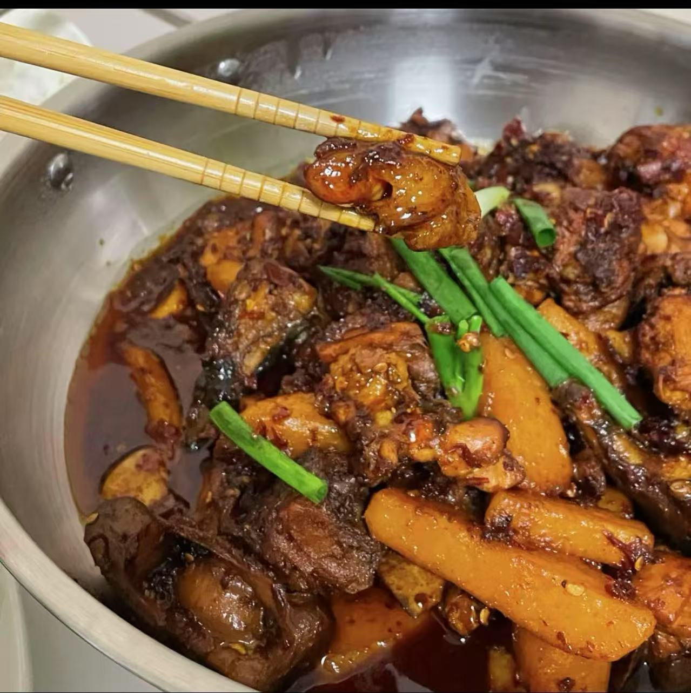

# 贵州辣子鸡的做法

贵州辣子鸡是贵州地区的经典家常菜，以糍粑辣椒和多种香料烹制而成，鸡肉香糯软烂，土豆绵密入味，整体风味香辣浓郁。鸡肉富含优质蛋白质，搭配土豆等配菜，营养均衡。这道菜步骤较多，对新手有一定挑战，但按部就班也能成功。从备料到出锅，预计需要 1.大约 5 小时。

预估烹饪难度：★★★★

预估卡路里：1441 大卡

## 工具

| 工具 | 备注 |
| --- | --- |

## 原料

每份：

| 食材 | 用量 | 分组 | 备注 |
| --- | --- | --- | --- |
| 农村玉米鸡 | 四斤 |  | 三到四个人的量，人多可依次累加 |
| 土豆 | 两个 |  |   |
| 蒜 | 两个 |  |   |
| 香叶 | 2 片 |  |   |
| 姜 | 两个 |  | 手指头大小 |
| 老抽 | 20 ml |  |   |
| 花椒 |   |  | 或麻椒 |
| 糍粑辣椒 | 500g |  | 花溪党武的辣椒，遵义的子弹头，条子椒，大方的皱椒混合之后打碎的辣椒；会是拳头大小两坨 |
| 豆瓣酱 |   |  |   |
| 啤酒 | 半瓶 |  |   |
| 蒜苗 | 三根 |  |   |
| 酒糟 |   |  |   |
| 食用油 |   |  |   |
| 菜籽油 | 两斤 |  | 开始炸鸡会用很多 |

## 操作

1. 在锅中加入和锅一半高度的油，将切成长条的土豆先炸至表面金黄然后捞出备用，等油温上至烤手时候将切好的鸡块放入锅中炸，并放入切好的生姜片和花椒
2. 刚开始炸鸡的时候，油是浑浊的，因为鸡块里面有水的原因，等到油炸至清澈，鸡块就炸好了，然后捞出备用
3. 现在锅里面的油可以捞三分之一出来，现在用不到这么多的油
4. 将锅中剩余的油加热，加入糍粑辣椒，豆瓣酱，生姜片，炒出红油状，将炸好的鸡块翻炒均匀
5. 等到鸡块都上色，加入老抽，倒入啤酒，啤酒一定要盖过鸡块，加上香叶盖上盖，闷十分钟，期间间隔翻炒
6. 然后加入土豆条，大蒜（不用切，一颗一颗的最好），然后再闷 20 分钟
7. 最后加入酒糟翻炒均匀再加入切好的蒜苗，就可以出锅了

## 附加内容

- 操作时，需要注意翻炒，因为糍粑辣椒会糊掉

如果您遵循本指南的制作流程而发现有问题或可以改进的流程，请提出 Issue 或 Pull request 。
