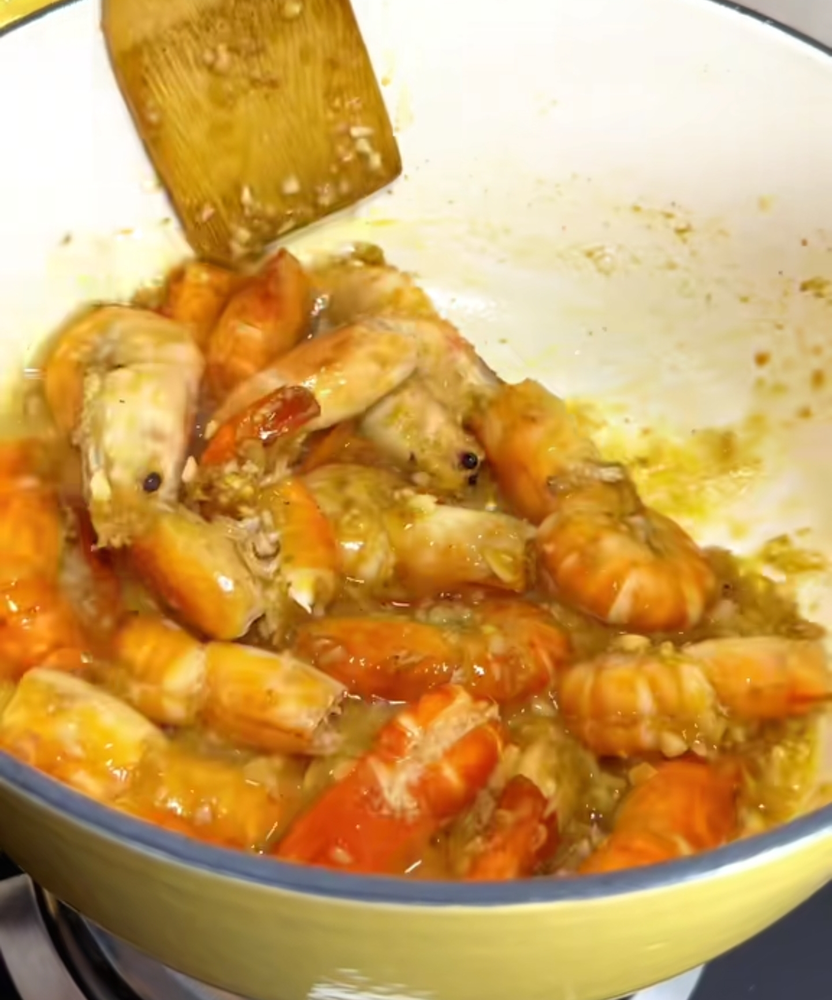

# How to Make Garlic Butter Shrimp

Garlic butter shrimp is a classic Western-style seafood dish: the shrimp are fresh, tender and springy, wrapped in rich garlic and butter, with a light hint of lemon. Shrimp is rich in high-quality protein, and the butter provides energy, making this a good way to refuel quickly. It's simple, needing only a few common ingredients, so beginners can handle it easily. It takes about twenty minutes from prep to plate.

Estimated difficulty: ★★

Estimated calories: 526 kcal

## Ingredients and Tools

- Large shrimp (black tiger shrimp or greasyback shrimp recommended)
- Unsalted butter (Anchor recommended)
- Garlic
- White wine (optional)
- Lemon
- Frying pan
- Kitchen tongs

## Calculation

Before cooking, decide how many portions to make. One portion is just enough for 1-2 people.

Per portion:

- Large shrimp 8-10 (about 200g)
- Unsalted butter 30g
- Garlic 4 cloves (about 20g)
- White wine 15ml (optional)
- Lemon 1/4
- Olive oil 10ml

## Steps

1. Remove the heads and shells from the shrimp, leaving the tails on. Remove the veins with a toothpick, rinse, and pat dry with paper towels
2. Mince the garlic and set aside
3. Heat the frying pan over medium heat and add 10ml of olive oil
4. When the oil is hot, add the shrimp and fry for 1-1.5 minutes per side until they change color. Remove and set aside
5. Add the butter to the same pan. Once melted, add the minced garlic and fry over low heat until fragrant (about 30 seconds)
6. If using white wine, add it now and cook until the alcohol evaporates (about 1 minute)
7. Return the shrimp to the pan and toss evenly with the garlic butter sauce (about 1 minute)
8. Squeeze in the lemon juice, toss evenly, and turn off the heat immediately
9. Plate and drizzle with the remaining sauce from the pan

## Additional Notes

- Don't overcook the shrimp, or they'll turn tough

If you follow this guide and find problems or possible improvements to the process, please open an Issue or Pull request.
