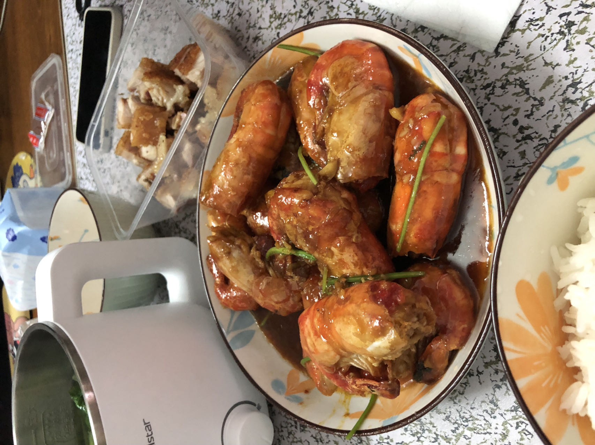

# How to Make Wasabi Butter Giant River Prawns

The highlight of this dish is the surprising combination of butter and wasabi: the prawn meat is firm and springy, and the sauce is rich and pungent. It's a modern-style seafood dish. Prawn meat is rich in high-quality protein and various trace elements for a balanced diet. The difficulty is moderate; as long as you prep the ingredients in advance and control the heat, beginners can succeed. From handling the live prawns to serving takes about 30 minutes.

Estimated difficulty: ★★★

Estimated calories: 637 kcal

## Ingredients and Tools

* Giant river prawns (Macrobrachium rosenbergii)
* Butter
* Wasabi
* White sugar
* Light soy sauce
* Oyster sauce
* Salt
* Cooking wine, rum or beer
* Cilantro
* Garlic

## Calculation

For 1 plate:

* Giant river prawns a little over 500g (1 jin); market price in Guangdong is about 40~45 yuan per jin
* Butter about 20g
* Wasabi 15g
* White sugar 3g
* Light soy sauce 30g
* Oyster sauce 30g
* Salt 3g
* Cooking wine, rum or beer 15g to 30g
* Cilantro 5 stalks, cut into segments
* Garlic 5 cloves, minced

## Steps

1. Trim off the sharp spikes at the head and tail, the antennae and the legs with scissors. Cut the prawns open along the back and remove the veins.
2. Mix the wasabi sauce in advance: soy sauce, oyster sauce, wasabi, salt and sugar, stirred evenly!
3. Wash the cilantro, cut into segments and set aside.
4. Drain the prawns well. Add oil to the pan, put the prawns straight in and fry over medium heat until golden on the outside, then remove.
5. Add the minced garlic and, over high heat, fry it in the oil left from the prawns. When white smoke rises from the pan and the garlic is fragrant, add the prawns and butter so the prawns fully absorb the butter's aroma
6. Add the prepared sauce, keep boiling on high heat, and toss the prawns until the sauce reduces, then add the alcohol (30g if using cooking wine or beer; rum has a strong flavor, so 15g is enough.)
7. When the sauce has reduced a bit more, add the cilantro, toss a couple of times, and serve.

## Additional Notes

* Mix the sauce and prep the butter in advance so you don't lose time prepping in the middle.
* Remember to add the garlic only after the prawns are fried and removed, so it doesn't fry too long and turn black and bitter.
* If you're not big on wasabi, add less; if you like it, add more. If you add too much, cook it a little longer and the wasabi flavor will dissipate.

If you follow this guide and find problems or possible improvements to the process, please open an Issue or Pull request.
