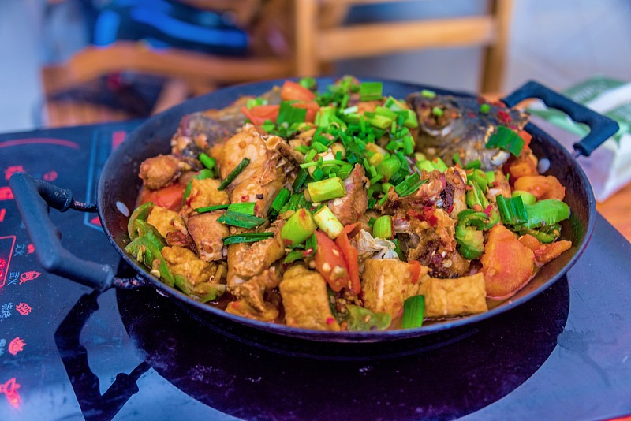

# How to Make Yangshuo Beer Fish

Yangshuo beer fish is a famous local dish from Yangshuo, Guangxi. Fresh Li River fish is pan-fried with its scales on, then braised in beer instead of water. The scales are crispy, the fish is fresh and tender, and the aroma of beer blends with the slight tartness of tomato for a rich, distinctive flavor. Fish is rich in high-quality protein and minerals, and the tomatoes and peppers add plenty of vitamins and whet the appetite. The difficulty is medium, a bit challenging for beginners, but following the steps will get you there. It takes about 30 minutes.

Estimated difficulty: ★★★

Estimated calories: 1092 kcal

## Ingredients and Tools

- Jianggu fish or carp (about 750g / 1.5 jin; have the vendor remove the innards but **don't scale it**)
- Liquan beer (one bottle, about 330ml; a local Guilin beer, the most authentic)
- Tomatoes (2)
- Green bell peppers (2)
- Red bell pepper (1)
- Garlic (5-6 cloves)
- Ginger (1 piece)
- Green onion (2 stalks)
- Guilin chili sauce
- Cooking wine
- Light soy sauce
- Dark soy sauce
- White sugar
- Salt
- Cooking oil

## Calculation

Per portion:

- Jianggu fish or carp 1 (about 750g, not scaled)
- Cooking wine 15ml
- Liquan beer 330ml (1 bottle)
- Tomatoes 2 (about 300g)
- Green bell peppers 2 (about 150g)
- Red bell pepper 1 (about 80g)
- Garlic 6 cloves (about 30g)
- Ginger 1 piece (about 20g)
- Green onion 2 stalks (about 40g)
- Guilin chili sauce 15g
- Light soy sauce 15ml
- Dark soy sauce 5ml
- White sugar 5g
- Salt 5g
- Cooking oil 30ml

## Steps

1. Remove the innards from the fish, keeping the scales on, and rinse clean. Cut it open from the belly into two halves (still joined at the back), and marinate with 15ml of cooking wine, ginger slices and 3g of salt for 15 minutes
2. Cut the tomatoes into chunks, cut the green and red peppers into pieces, smash the garlic, slice the ginger, and cut the green onion into segments (keeping the white and green parts separate)
3. Rub the bottom of the wok with a ginger slice. Heat the wok, add 30ml of cooking oil, and when the oil is hot, add the fish (skin side down). Fry until golden on both sides and the scales are crispy, then remove and set aside
4. Leave a little oil in the wok and fry the green onion whites, ginger slices and garlic until fragrant
5. Add 15g of Guilin chili sauce and stir-fry until the oil turns red
6. Add the tomato chunks and stir-fry until the tomatoes release their juice and soften
7. Pour in the whole bottle of beer, add 15ml of light soy sauce, 5ml of dark soy sauce, 5g of white sugar and 5g of salt, and stir well
8. Add the fried fish, bring to a boil on high heat, then turn to medium-low heat, cover and braise for 15-20 minutes
9. Remove the lid, add the green and red pepper pieces, and cook for another 3-5 minutes
10. Reduce the sauce on high heat until thick, sprinkle with the green onion greens, and plate

## Additional Notes

- The scales are the key feature of this dish; be sure to keep them. They become crispy and delicious when fried
- Cutting the fish into two halves makes it easier to fry through and absorb flavor, working better than scoring a whole fish
- The authentic method uses Guilin chili sauce (not Pixian doubanjiang) with Liquan beer. If you don't have Guilin chili sauce, use garlic chili sauce instead
- Fry the tomatoes until soft and juicy so the sauce is richer
- Don't reduce the sauce too much; leave some for mixing with rice or noodles, it's delicious
- Reference: [How to make Yangshuo beer fish](https://www.bilibili.com/video/BV1rt4y1976z)

If you follow this guide and find problems or possible improvements to the process, please open an Issue or Pull request.
