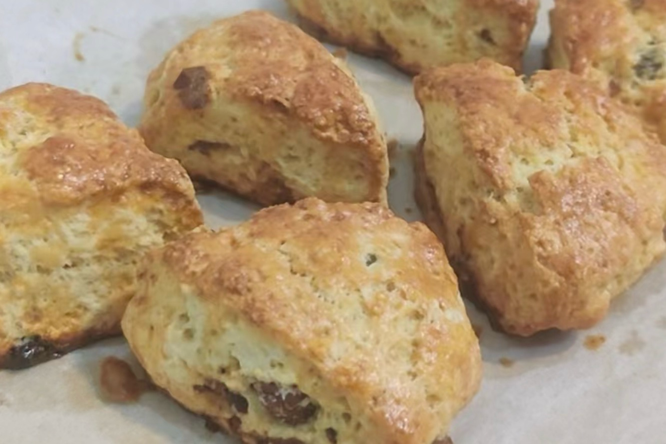

# How to Make English Scones

English scones are a classic British afternoon tea treat: crisp outside, soft inside, with a rich egg and dairy aroma, even better with jam or cream. They're mainly made of flour, butter, egg and cream, rich in carbohydrates and protein for a quick energy boost. The process is fairly simple; as long as you master basic dough handling, beginners can do it. It takes about an hour from prep to out of the oven.

Estimated difficulty: ★★★

Estimated calories: 1197 kcal

## Ingredients and Tools

- Unsalted butter (President brand recommended)
- Cake flour
- Sugar
- Salt
- Baking powder
- Egg
- Whipping cream
- Cream cheese (optional)

## Calculation

Before cooking, decide how many portions to make. One portion is just enough for 4-6 people.

Per portion:

- Unsalted butter 40g
- Cake flour 180g
- Sugar 30g
- Salt 1g
- Baking powder 5g
- Egg 1 (about 50g)
- Whipping cream 45g
- Cream cheese 50g

## Steps

1. Beat the egg, weigh out 30g of it into a clean container, and mix in all of the whipping cream and cream cheese. If the cream cheese is too firm, warm it in a water bath to about 40 degrees before mixing.
2. Mix the cake flour, salt, sugar and baking powder evenly in a clean container
3. Cut the butter into small pieces, add to the mixture from the previous step, and rub the butter in with your fingers until it looks like coarse cornmeal
4. Pour the egg and cream mixture from step 1 into the flour and butter mixture, and stir until nearly combined. Fold and press into an even dough
5. Put the dough on the board, roll it out 1.5cm thick, and cut into suitable shapes with a knife or cutter
6. Brush the tops of the scones with the remaining 20g of beaten egg
7. Preheat the oven to 180 degrees and bake for 27 minutes

## Additional Notes

- The simplest way to cut them is to roll the dough into a round and cut it into 6 wedges

If you follow this guide and find problems or possible improvements to the process, please open an Issue or Pull request.
