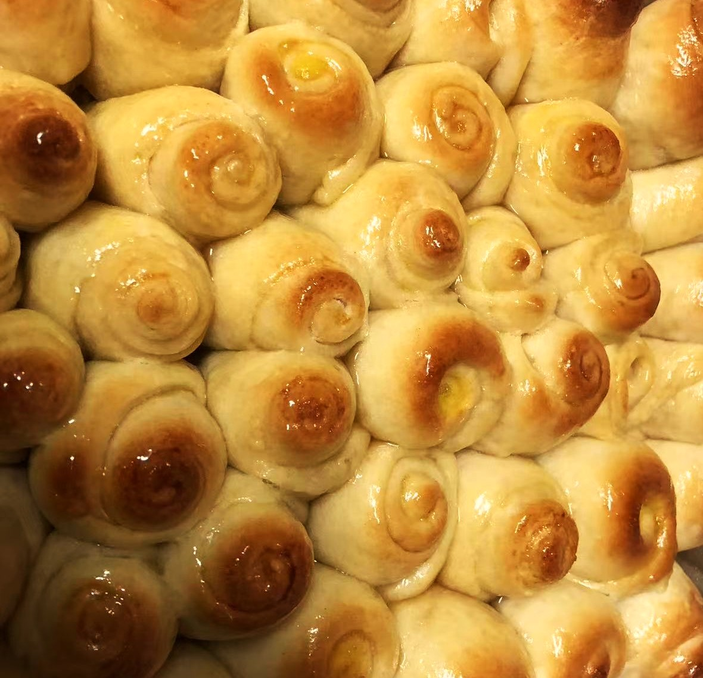

# How to Make Honey Bread Rolls without a Stand Mixer

These are home-style honey bread rolls that don't need a stand mixer: soft and sweet, with slightly crisp bottoms, brushed with honey water and sprinkled with sesame seeds for a simple, sweet aroma. The main ingredients are bread flour, milk, eggs and butter, providing plenty of carbohydrates, protein and calcium, a reassuring choice for breakfast or a snack. It's simple: everything is kneaded by hand, the proofing time is flexible, and you can even put the rolls in the refrigerator the night before and bake them the next day, which makes it quite beginner-friendly. It takes about 3 hours, most of which is waiting for the dough to rise; the actual hands-on work isn't much effort.

Estimated difficulty: ★★★★★

Estimated calories: 176 kcal

## Ingredients and Tools

For the bread

- Bread flour: 400g
- Milk: 200g
- Yeast: 4g
- Egg: 1
- Granulated sugar: 70g
- Salt: 2g
- Butter: 30g

Honey water (brushed on top)

- Honey: 20g
- Water: 20g

Optional (sprinkled on top)

- Sesame seeds

## Calculation

The amounts below are baked using one rectangular pan (10 x 15 inches, about 25 x 38 cm) + one square pan (9 × 9 inches, about 23 × 23 cm) + parchment paper. Consider reducing the amounts to suit your needs; eating them for breakfast, this lasts about two weeks (stored in the refrigerator). They harden in the refrigerator; just microwave for 10 - 20s.

## Steps

1. Make the dough: mix the flour, milk (warming it to 40° is recommended; I microwave it for 15 - 20s), yeast, egg, sugar and salt.
2. Stir the dough until the ingredients come together evenly into a ball.
3. Add the butter and mix it in.
4. Keep stirring + kneading by hand until evenly combined.
5. Let the dough rise: cover the container with plastic wrap and leave at normal temperature (10 - 20°) for 1 - 2 hours. A slightly longer time doesn't affect the result much.
6. Once the dough has clearly risen (doubled in size), you can start dividing it. At this point the dough should no longer be very sticky.
7. Divide the dough: ideally each piece is 60g (looks nice), but adjust the size as you like.
8. Roll each small piece of dough into a tongue shape with a rolling pin and roll it up, then let it rest again for 10 minutes.
9. Roll it out into a tongue shape again, roll it up, and cut it in the middle (one becomes two).
10. Roll each out into a tongue shape again, roll it up, and cut it in the middle (two become four). (You can roll and fold this a few more times depending on your time; just keep an eye on the size of each piece)
11. Line the pans with parchment paper and pour in peanut oil. Dip the bottom of each rolled piece in water + flour and place it in the pan.
12. Proof again (covered with plastic wrap). For this step you can put them in the refrigerator and bake the next day.
13. Brush with beaten egg.
14. Bake at 180° (355°F) for 18 - 20 minutes.
15. When they come out of the oven, brush with honey water and sprinkle with sesame seeds.

## Additional Notes

- The rising time isn't fixed. Check every hour; once it has clearly grown, it's done. Letting it rise to 2 - 2.5 times its size is recommended.
- The size of the dough pieces doesn't significantly affect texture or baking; adjust to your liking.
- Reference: Xiachufang - Crispy-bottom honey bread rolls

If you follow this guide and find problems or possible improvements to the process, please open an Issue or Pull request.
