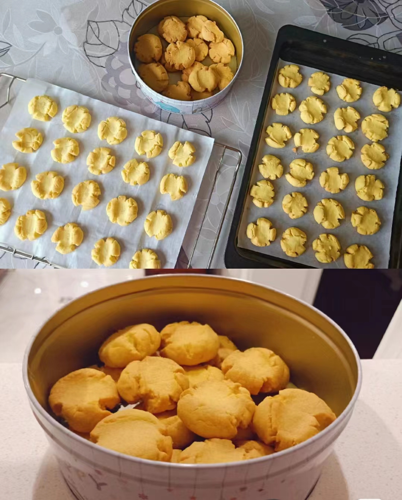

# How to Make Margherita Cookies

Margherita cookies (Biscotti Margherita) are crumbly and tender with a rich buttery aroma, a classic little Western dessert. They're mainly made of egg yolk, butter and flour, rich in carbohydrates and fat for a quick energy boost. The difficulty is moderate; it takes about 45 minutes from prep to out of the oven, and beginners can make them easily.

Estimated difficulty: ★★★

Estimated calories: 863 kcal

## Ingredients and Tools

- Hard-boiled egg yolk
- Butter
- Granulated sugar
- Salt
- Cake flour
- Corn starch
- Oven

## Calculation

Given how high in calories these little treats are, decide how many portions to make before you start. One portion is just enough for one person.

Per portion:

- Hard-boiled egg yolk 1
- Butter 50 grams
- Granulated sugar 20 grams
- Salt 1 gram
- Cake flour 50 grams
- Corn starch 50 grams

## Steps

1. Melt the butter over hot water and mash the egg yolk. Set aside.
2. Add the sugar, salt and mashed egg yolk to the melted butter and stir evenly
3. Add the cake flour and corn starch and knead into a dough
4. Divide the dough evenly into small pieces of about 8 grams each, and roll them into balls.
5. Press your thumb gently onto each ball to create cracks.
6. Preheat the oven to 150℃, put the cookies in, and bake for 20 minutes.
7. Let them cool slightly, then enjoy

## Additional Notes

- You can fine-tune the salt and sugar to taste. For other flavors, replace 3 grams of the corn starch per portion with cocoa powder or matcha powder.
- If possible, sift the egg yolk, cake flour and other ingredients for a better texture.
- Granulated sugar was chosen because it's easy to get; if possible, use 30 grams of powdered sugar instead.
- If you don't have an oven, you can use a microwave or air fryer: microwave on high for 2-3 minutes, or air fry at 150℃ for 20 minutes
- Reference: [The 100th mailable cookie: crumbly, tender and melts in your mouth~ - Bilibili](https://b23.tv/NZCsV0x)

If you follow this guide and find problems or possible improvements to the process, please open an Issue or Pull request.
