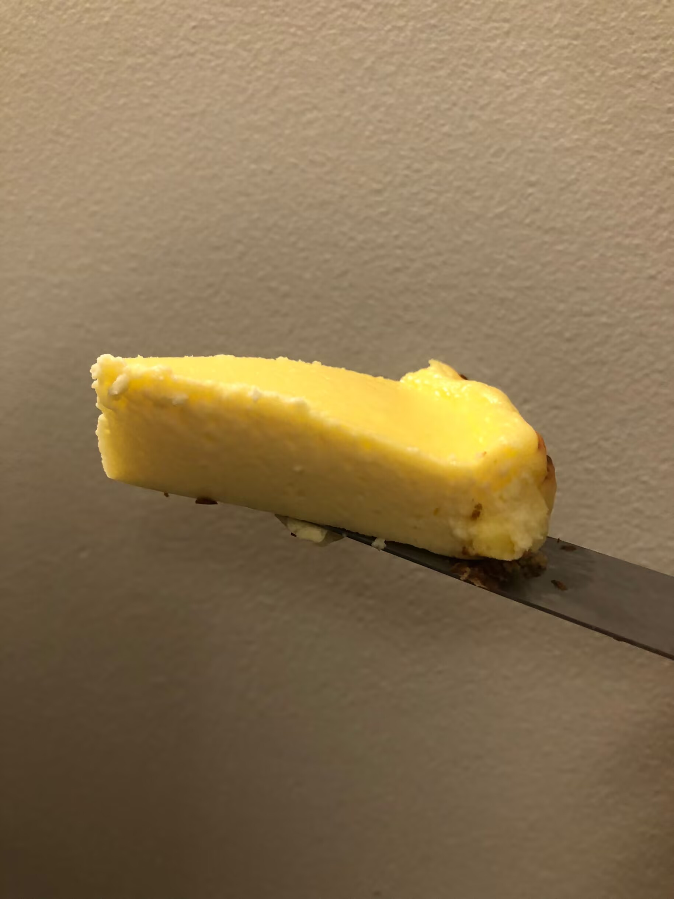

# How to Make Oven Basque Cheesecake

Basque cheesecake is a dessert that's rich and creamy, with a caramelized top and a moist interior, a classic from the Basque region of Spain. The main ingredients are cream cheese and eggs, rich in high-quality protein and calcium. It's very simple; beginners can handle it easily. It takes only about 30 minutes from prep to out of the oven, but it's best chilled overnight before eating, for a total of 8+ hours.

Estimated difficulty: ★★

Estimated calories: 266 kcal

## Ingredients and Tools

- Cream cheese: 212g (the weight of one block, which is convenient; the original tutorial uses 250g)
- Granulated sugar: 60g
- Eggs: 2
- Egg yolk: 1
- Whipping cream: 120g
- Cake flour: 10g

Optional (chocolate flavor)

- Chocolate: 38g (I've only tried melting regular chocolate and stirring it in evenly at the whipping cream step)

## Calculation

The amounts below are baked in a 7-inch round pan; the original tutorial uses a 6-inch round pan.

## Steps

1. Soften the cream cheese in the microwave, 10s + 10s.
2. Add the sugar to the cream cheese and beat with a whisk until smooth.
3. Add 2 whole eggs + 1 yolk and mix evenly.
4. Add the whipping cream and mix evenly.
5. Add the cake flour and mix evenly.
6. Bake at 220° (425°F) for 20 - 25 minutes (I usually do 20 or 22 minutes).
7. Let it cool, then put it in the refrigerator, ideally overnight.

## Additional Notes

- It's normal for the cake to wobble when it comes out of the oven. After cooling it still isn't at its best; it must be chilled to taste great!
- Reference: Xiachufang - Basque cheesecake, "the simplest cake", foolproof 🔥 for cheese lovers

If you follow this guide and find problems or possible improvements to the process, please open an Issue or Pull request.
