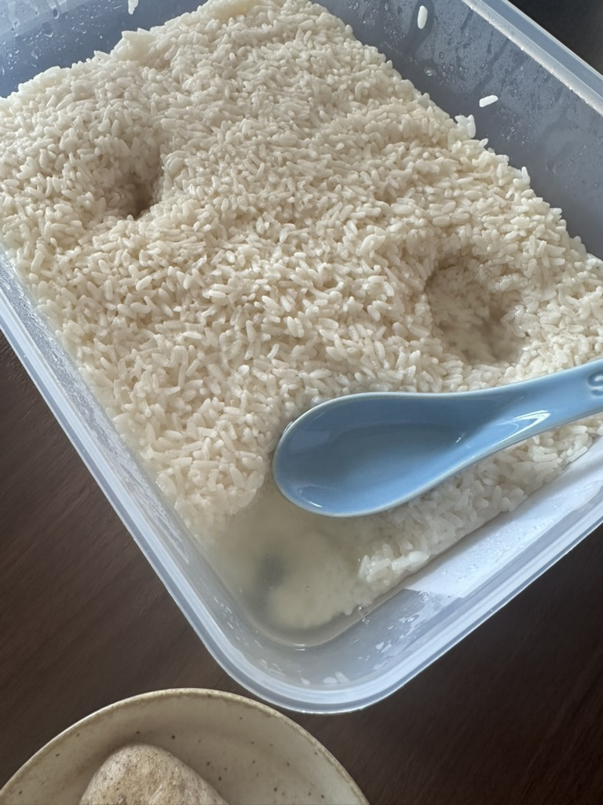
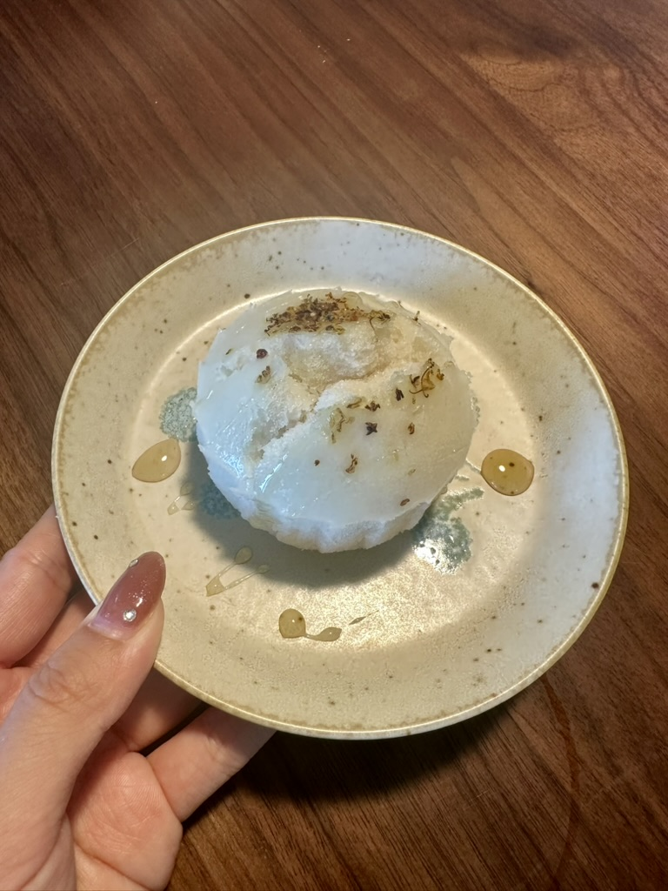

# How to Make Jiuniang (Fermented Sweet Rice)

This is a traditional Chinese fermented sweet, light and sweet with a gentle buzz and a faint aroma of rice wine. It's said to strengthen the spleen, whet the appetite and aid digestion. The process is simple and fun; although you need to wait for fermentation, the hands-on work isn't complicated, making it a great introduction to fermentation. The total time is about 2 days, of which the actual hands-on time is only about 1 hour.

Estimated difficulty: ★★★★

Estimated calories: 420 kcal

## Ingredients and Tools

- Glutinous rice 800g (round glutinous rice recommended)
- One packet of Angel sweet rice wine starter (8g) (although the ratio is 3g per 1000g of glutinous rice, using more starter improves the chance of success)
- Water 720g + 600g (720g for steaming the rice, the rest for fermentation)
- Steamer (a rice cooker works)
- Thermometer (optional but recommended)
- 1 clean, sealable glass or ceramic container

## Calculation

This recipe is 1 portion and serves 6～8 people.

## Steps

1. Rinse 800g of glutinous rice and put it in the rice cooker, add 720g of water, and select the rice cooking mode
2. Once cooked, turn the rice out and spread it to cool to 30°C using clean tools (measuring with a thermometer is best; it should feel warm but not hot)
3. Dissolve 8g of Angel sweet rice wine starter in 20ml of warm water (about 30°C), sprinkle it evenly over the rice, and mix well
4. Add 600g of water to the rice to help mix in the starter evenly. After 2-3 minutes, the rice will have soaked up the water. Adding water now gives the jiuniang plenty of liquid from the first fermentation
5. Use a rolling pin to make a small hole in the center of the rice (so the wine can collect)
6. Put the mixed rice in a clean container, gently press the surface flat, and seal it with a lid or plastic wrap
7. Ferment in a 28 ～ 32°C environment for 24 ～ 48 hours. Don't shake or move it vigorously during fermentation
8. Fermentation has succeeded when clear rice wine has seeped into the central hollow, it has a slight wine aroma overall, and there are no off smells or sourness
9. After fermentation, you can refrigerate it right away (you can add osmanthus at this point). Use clean utensils each time you take some out. It keeps refrigerated for 7 ～ 10 days

10. You can do a second fermentation, adding 500ml of water to increase the yield (up to 800g of water)
11. Jiuniang keeps fermenting. To stop fermentation, steam it for 10 minutes to sterilize it, or keep it in the refrigerator

### Advanced Version 1: Pre-Soaked Rice

1. Rinse 800g of glutinous rice and soak it in water for 6 ～ 8 hours (8 ～ 10 hours in winter), until the grains are plump
2. Drain the rice, put it in a steaming cloth, and steam over water for 40 ～ 60 minutes. Open the lid every 20 minutes and turn the rice so it cooks evenly
3. Once cooked, turn the rice out to cool, add the starter, and continue with the same steps as above

### Advanced Version 2: Mixed Rice

1. Of course, experienced jiuniang makers can experiment with different rice combinations. You can replace 20% of the glutinous rice with millet, oats, glutinous millet, black glutinous rice and so on

## Additional Notes

- Fermentation temperature is crucial: too low and fermentation is slow or fails, too high and the starter is killed
- Common causes of failure: temperature too high, mixing in the starter while the rice is too hot, or a container that wasn't clean or got water or oil in it
- It can be heated and eaten with tangyuan, egg drop, goji berries and so on, but don't boil it too long or the wine aroma will be lost
- The liquid can be used to make jiuniang rice cakes, jiuniang pancakes and more, and also as a seasoning to add flavor to beef rice bowls and teriyaki sauce

If you follow this guide and find problems or possible improvements to the process, please open an Issue or Pull request.
