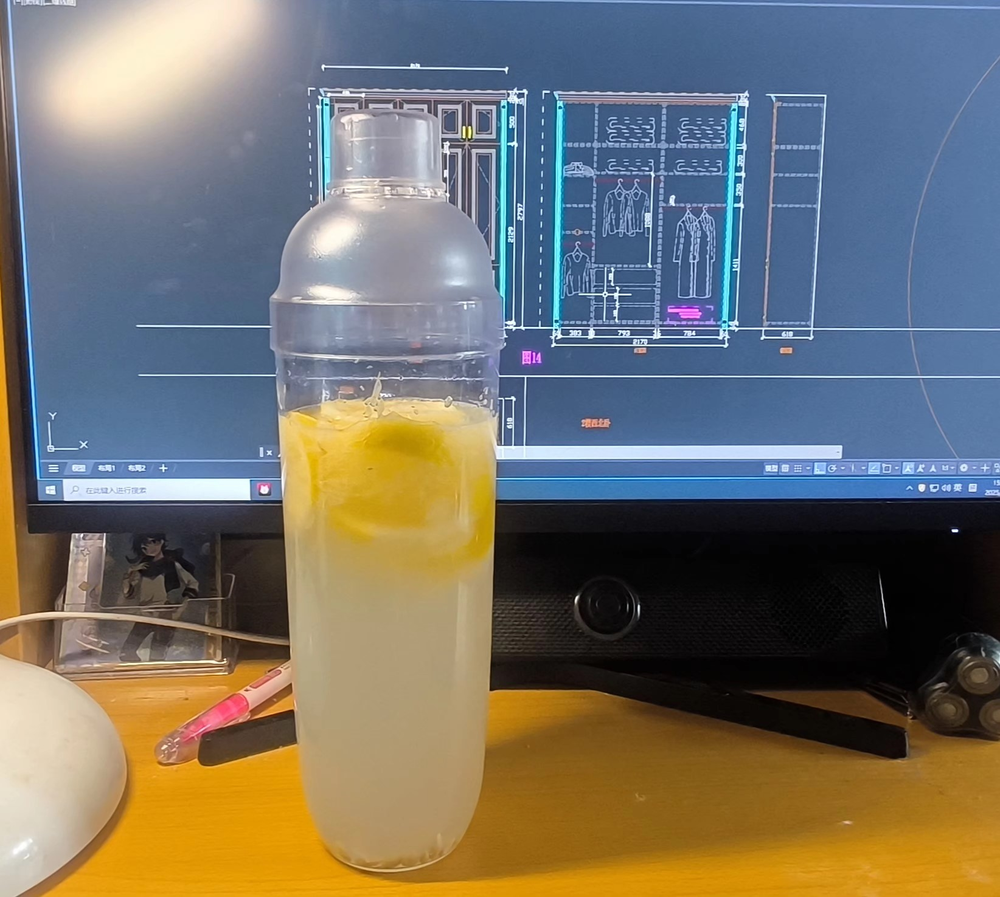

# How to Make Lemonade

This drink stars fresh lemon balanced with fruit syrup for a perfect sweet-sour balance, even more refreshing and cooling when iced. Lemons are rich in vitamin C; drinking it regularly helps with nutrition, gives you a lift and is said to brighten the skin. The steps are minimal—just muddle, add ingredients and shake—so beginners can finish it in three to five minutes.

Estimated difficulty: ★

Estimated calories: 141 kcal

## Ingredients and Tools

- Ingredients
  - Lemon
  - Fruit syrup
  - Ice (optional)
- Tools
  - Cocktail shaker

## Calculation

One glass, about 500 ml

- Lemon 40~45 grams
- Fruit syrup 40~45 grams
- A few ice cubes (optional)

## Steps

1. Weigh out 40~45 grams of lemon and put it in the shaker
2. Pound it about 10 times with the shaker cap
3. Add 40~45 grams of fruit syrup
4. Top up with water
5. Shake well
6. Finally, add ice to taste

## Additional Notes

- Reference: [Lemonade tutorial](https://v.douyin.com/TVNTcXDi46I)

If you follow this guide and find problems or possible improvements to the process, please open an Issue or Pull request.
