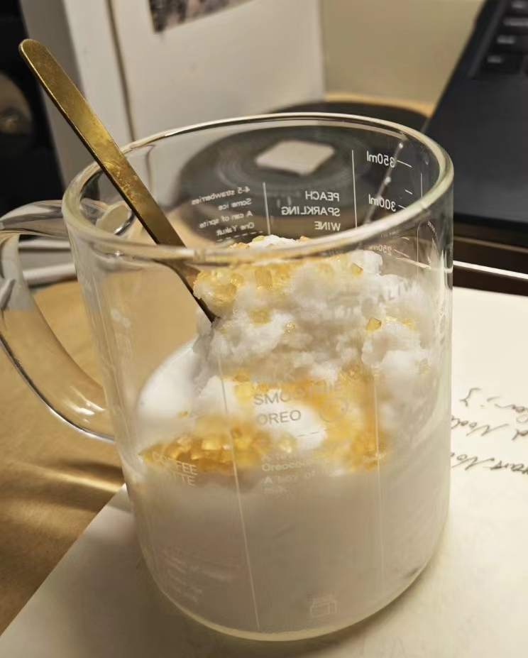

# How to Make Sugared Coconut Slush

Sugared coconut slush is a quick cold drink full of tropical flair: sweet coconut aroma blends with the caramel notes of coarse brown sugar for a creamy, icy texture. Coconut water is rich in natural electrolytes and minerals for quick hydration, and coffee sugar adds carbohydrate energy. There's almost no barrier to entry: just freeze the coconut drink solid in advance and smash it into slush. No pressure for beginners. You need to start freezing more than 10 hours ahead, but the hands-on work takes only a few minutes, making it great as a leisurely afternoon treat.

Estimated difficulty: ★

Estimated calories: 231 kcal

## Ingredients and Tools

- Bottled coconut drink (a bottle with a wider mouth is better)
- Coffee sugar (coarse yellow crystals)

## Calculation

The best portion size for slush usually depends on how fast it melts. 300g of slush made at -18 degrees usually lasts about 30 minutes at room temperature.

Per portion:

- Bottled coconut drink 500ml
- Coffee sugar 10g (two packets of Taikoo coffee sugar)
- Chopped nuts (optional)

## Steps

1. Pour out 200ml from a 500ml bottle of coconut drink and immediately screw the cap back on tightly.
2. Put the bottle in the freezer and freeze for more than 10 hours.
3. Take out the bottle. Once you've confirmed the coconut drink inside is completely frozen, smack it hard against a hard surface such as a wall corner, chair back or table corner. (Make sure the surface won't be damaged)
4. Once the frozen coconut drink has been smacked into a slush, open the cap and pour it out.
5. Sprinkle the coffee sugar or chopped nuts evenly over the slush.
6. Done

## Additional Notes

- In the steps above, the bottled coconut drink can be frozen in advance, but not for more than 7 days, or it may spoil.

If you follow this guide and find problems or possible improvements to the process, please open an Issue or Pull request.
