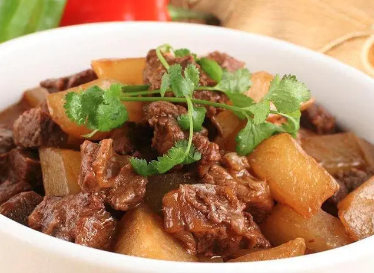

# How to Make Cantonese Beef Brisket with Radish

This is a Cantonese home-style braise: the brisket is tender and full of flavor, and the radish soaks up the broth to become sweet and rich, with a savory sauce and sweet finish overall. It's rich in high-quality protein and dietary fiber, appetizing and good for digestion. There are a few more steps, but the difficulty is moderate and beginners can succeed by following them in order. It takes about 2.5 hours from start to finish.

Estimated difficulty: ★★★★

Estimated calories: 483 kcal

## Ingredients and Tools

- Beef brisket
- White radish (daikon)
- Ginger slices
- Garlic cloves
- Green onion
- Star anise
- Cassia bark
- Dried chili peppers
- Bay leaves
- Red fermented bean curd (nanru)
- Chu hou sauce
- Oyster sauce
- Soy sauce
- Rock sugar
- Salt
- Dark soy sauce

## Calculation

One portion is just enough for 3-4 people.

- Beef brisket 500g
- White radish 1
- Ginger 8 slices
- Garlic 5 cloves
- Green onion knot, one handful
- Star anise 2
- Cassia bark 1 small piece
- Dried chili peppers 2
- Bay leaves 2
- Red fermented bean curd 1 cube
- Chu hou sauce 30g
- Oyster sauce 15g
- Soy sauce 15g
- Rock sugar 10g
- Salt 5g
- Dark soy sauce 15g

## Steps

### Cooking

1. Roll-cut the radish into chunks and set aside
2. Blanch the brisket whole with 2 slices of ginger and a handful of green onion knots: once the water boils, cook for 5-10 minutes, then take it out to cut
3. Cut the brisket into pieces of whatever size you like (since the brisket has been blanched, it basically won't shrink much when braised; larger pieces need a bit longer to braise)
4. Prepare the braising sauce: mix the red fermented bean curd, chu hou sauce, soy sauce, oyster sauce, sugar and salt in the amounts above (I'd just run out of rock sugar, so I used white sugar instead)
5. Heat the wok with oil, fry the ginger and garlic until fragrant, add the brisket and stir-fry until dry, then add the prepared sauce and stir-fry until fragrant. If you like a deeper color, add a little dark soy sauce
6. Once the seasonings are fully mixed in, pour in hot water
7. Transfer the brisket to a stockpot, add the cassia bark, star anise, bay leaves and dried chilies, and braise for about 2 hours
8. Once the brisket is half tender, add the white radish and braise for another 30 minutes
9. When the radish is soft, it's done—a pot of fragrant radish and beef brisket

## Additional Notes

If you follow this guide and find problems or possible improvements to the process, please open an Issue or Pull request.
