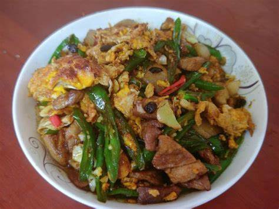

# How to Make Farmhouse Pork and Egg Stir-fry

Nongjia yi wan xiang ("a fragrant bowl from the farmhouse") is a savory Hunan home-style stir-fry that goes great with rice: the richness of pork belly, the tenderness of egg and the freshness of green chilies blend into layered flavors. Pork and eggs provide high-quality protein, and green chilies add vitamin C for a balanced meal. It's medium difficulty: you need to watch the frying heat and the order of seasoning, but beginners can do it well with a little practice. Prep takes about 7 minutes and cooking 10 minutes, about 17 minutes in total.

Estimated difficulty: ★★★

Estimated calories: 1638 kcal

## Ingredients and Tools

+ Pork (pork belly recommended)
+ Green chili peppers
+ Garlic slices
+ Doubanjiang (chili bean paste)
+ Soy sauce
+ Bird's eye chili
+ White sugar
+ Ginger slices

## Calculation

Before cooking, decide how many portions to make. One portion here is enough for 1~2 people.

+ Pork 250g
+ Green chili peppers 3
+ Garlic 2 slices
+ Doubanjiang 10g
+ Bird's eye chili 1
+ White sugar 5g
+ Soy sauce 15ml
+ Ginger 2 slices

## Steps

1. Prep: slice the pork, ideally keeping the fatty and lean parts separate. Cut the green chilies and bird's eye chili into segments, crush the garlic slices into minced garlic with the back of a knife, and cut the ginger into shreds. Crack the eggs into a small bowl and beat with chopsticks.
2. With everything prepped, you can start cooking. Pour oil into the wok over low heat. When the oil is hot, pour in the beaten eggs and scramble them until just set, then put them back in the small bowl.
3. Add a bit more oil to the wok over low heat. When the wok is hot, add the fatty pork you cut earlier to render out the lard.
4. When the fat turns golden, raise the heat to medium and add the lean pork to stir-fry together.
5. When all the lean pork has changed color, add the prepared ginger shreds, minced garlic and doubanjiang and stir-fry evenly to color the pork.
6. Add the green and red chilies and the scrambled eggs, then add the soy sauce and sugar, and keep stir-frying until the green chilies are just barely cooked, keeping them crisp.
7. Serve!

## Additional Notes

+ If you used too much oil when scrambling the eggs, you can skip adding oil when frying the pork, depending on the situation.
+ Reference: [Xiachufang](https://www.xiachufang.com/recipe/106817581/)

If you follow this guide and find problems or possible improvements to the process, please open an Issue or Pull request.
