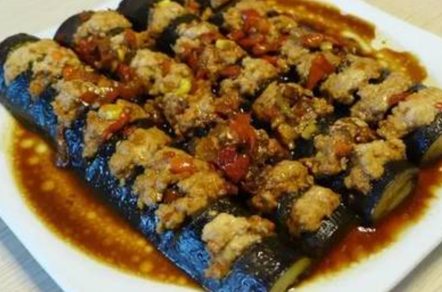
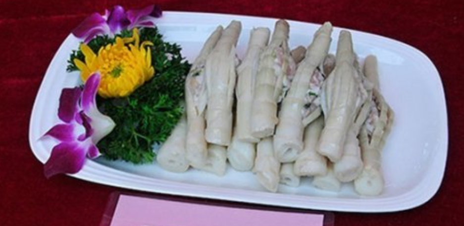
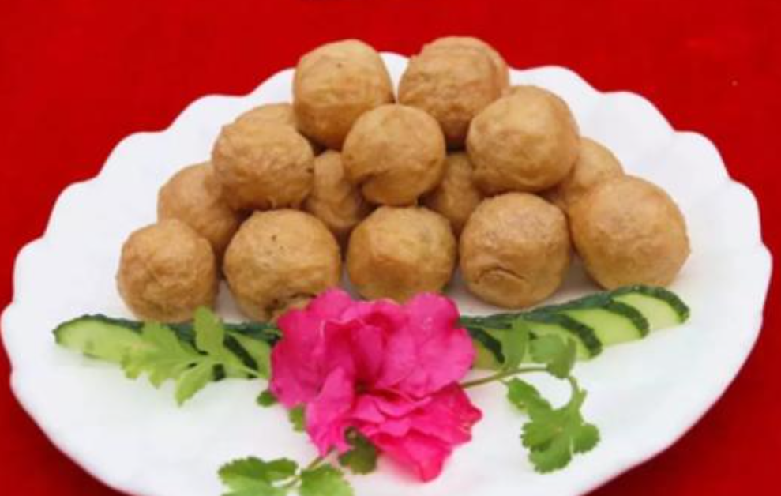

# How to Make Guilin Eighteen Stuffed Dishes


Guilin's "eighteen stuffed dishes" (shiba niang) are a traditional series of stuffed foods: seasoned fillings such as pork or shrimp paste are stuffed into more than a dozen hollow ingredients like green peppers, bitter melon, river snails and eggplant, then pan-fried and braised. Each dish has its own flavor—fresh, fragrant and juicy, tender or springy—a rich local home-style taste. The fillings provide high-quality protein, and the variety of vegetables adds vitamins and dietary fiber for fairly balanced nutrition. You need to stuff each one and manage the heat, which takes a little patience, but the logic is simple and even kitchen beginners can try it. It takes about 1.5 hours to make everything.

Estimated difficulty: ★★★

Estimated calories: 468 kcal

## Ingredients and Tools

**Wrapper — anything tube-shaped will do:**

- Green peppers, bitter melon, eggplant, river snails, tofu, shiitake mushrooms, pumpkin flowers
- Pomelo peel, bamboo shoots, winter melon, taro, garlic, tomatoes, bean sprouts, eggs, wild mushrooms
- Principle: everything can be stuffed

**Filling — mainly meat:**

- Pork filling (the base version, 3:7 fat to lean)
- Shrimp paste filling (fork version)
- Fish filling
- Mixed filling (pork + shrimp paste, pork + snail meat, any combination you like)

## Calculation

18 wrappers × 4 fillings = 72 combinations; about 20-odd combinations are commonly used in practice.

Core formula: **tube-shaped ingredient + meat filling + pan-fry/braise = niang (stuffed dish)**

## Steps

### Core Idea

"Niang" (酿) means finding a hollow, tube-shaped ingredient as a container, stuffing it with seasoned meat filling, then pan-frying or braising it until cooked.

Taking the two stuffed dishes already in this repository as examples:

1. **Stuffed green peppers**: seed and hollow out green peppers → stuff with pork filling or shrimp paste → pan-fry until blistered → braise in sauce
2. **Stuffed river snails**: blanch the snails and remove the meat → chop the snail meat and pork together → stuff back into the shells → braise with perilla and mint

Swap in another tube-shaped ingredient and repeat the same process, and you have a new dish. Stuffed bitter melon, stuffed eggplant, stuffed tofu... all work the same way.

The filling can vary too:

3. **Pork filling**: the most basic, all-purpose choice; 3:7 fat to lean gives the best texture
4. **Shrimp paste filling**: sweet and springy, often used in stuffed green peppers
5. **Snail and pork mixed filling**: the soul of stuffed river snails, snail meat and pork 1:1, with perilla and mint
6. **Mixed filling**: pork + shrimp paste, getting both sweetness and rich fattiness

One container with one filling; swap one, and it's a new stuffed dish. The local saying "everything can be stuffed" captures exactly this.

### Bridge Pattern

Decouple the "container" from the "filling" so that each varies independently and they can be combined freely:

```text
Abstraction (Abstract Wrapper): tube-shaped ingredient (CylindricalContainer)
    ├── StuffedGreenPepper extends CylindricalContainer
    ├── StuffedBitterMelon extends CylindricalContainer
    ├── StuffedEggplant extends CylindricalContainer
    ├── StuffedRiverSnail extends CylindricalContainer
    ├── StuffedTofu extends CylindricalContainer
    ├── StuffedShiitake extends CylindricalContainer
    ├── StuffedPumpkinFlower extends CylindricalContainer
    ├── StuffedPomeloPeel extends CylindricalContainer
    ├── StuffedBambooShoot extends CylindricalContainer
    ├── StuffedWinterMelon extends CylindricalContainer
    ├── StuffedTaro extends CylindricalContainer
    ├── StuffedGarlic extends CylindricalContainer
    ├── StuffedTomato extends CylindricalContainer
    ├── StuffedBeanSprout extends CylindricalContainer
    ├── StuffedEgg extends CylindricalContainer
    ├── StuffedWildMushroom extends CylindricalContainer
    └── ... everything can be stuffed

Implementation (Filling Implementation): meat filling (MeatFilling)
    ├── PorkFilling implements MeatFilling
    ├── ShrimpPasteFilling implements MeatFilling
    ├── FishFilling implements MeatFilling
    └── MixedFilling implements MeatFilling  // pork + shrimp paste, pork + snail meat...
```

Swap the wrapper and it's a new dish; swap the filling and it's another variant.

## Additional Notes

### Existing Recipes

- [Stuffed Green Peppers](./stuffed-green-peppers.md) — pork-stuffed green peppers / shrimp paste-stuffed green peppers (fork version)
- [Stuffed River Snails](./stuffed-river-snails.md) — snail meat and pork 1:1, with perilla and mint

### Stuffed Dish Gallery







If you follow this guide and find problems or possible improvements to the process, please open an Issue or Pull request.
