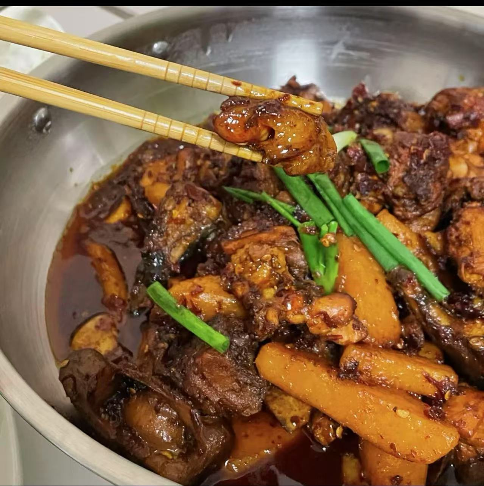

# How to Make Guizhou Chili Chicken

Guizhou chili chicken (Guizhou lazi ji) is a classic home-style dish from Guizhou, cooked with ciba chili paste and a variety of spices: the chicken is fragrant, sticky and tender, the potatoes soft and full of flavor, with an overall rich, spicy aroma. Chicken is rich in high-quality protein, and with potatoes and other sides it's nutritionally balanced. There are quite a few steps, which is challenging for beginners, but following them in order will get you there. It takes about 1.5 hours from prep to plate.

Estimated difficulty: ★★★★

Estimated calories: 1441 kcal

## Ingredients and Tools

- Free-range corn-fed chicken
- Potatoes
- Garlic
- Bay leaves
- Ginger
- Dark soy sauce
- Sichuan peppercorns or numbing peppercorns
- Ciba chili paste (a blend of Huaxi Dangwu chilies, Zunyi bullet chilies, long chilies and Dafang wrinkled chilies, pounded into a paste)
- Doubanjiang (chili bean paste)
- Beer
- Garlic sprouts
- Fermented rice lees (jiuzao)
- Cooking oil

## Calculation

Per portion:

- Chicken: for three to four people, 2kg (4 jin); scale up for more people
- Beer half a bottle
- Ginger two pieces about the size of a finger
- Ciba chili paste 500g, about two fist-sized lumps
- Garlic sprouts 3 stalks
- Bay leaves 2
- Garlic 2 bulbs
- Potatoes 2
- Rapeseed oil 1kg (2 jin); frying the chicken at the start uses a lot
- Dark soy sauce 20 ml

## Steps

1. Fill the wok halfway with oil. First fry the potatoes, cut into long strips, until golden on the surface, then remove and set aside. When the oil is hot enough that you can feel the heat with your hand above it, add the cut chicken pieces to fry, along with the sliced ginger and Sichuan peppercorns
2. When you first start frying the chicken, the oil is cloudy because of the water in the chicken. Once the oil turns clear, the chicken is done; remove and set aside
3. Now you can scoop out about a third of the oil from the wok; you don't need this much anymore
4. Heat the remaining oil, add the ciba chili paste, doubanjiang and ginger slices, and fry until the oil turns red. Add the fried chicken and toss evenly
5. When all the chicken is colored, add the dark soy sauce and pour in the beer—the beer must cover the chicken. Add the bay leaves, cover, and braise for ten minutes, stirring occasionally
6. Then add the potato strips and garlic (no need to cut; whole cloves are best), and braise for another 20 minutes
7. Finally add the fermented rice lees, toss evenly, add the chopped garlic sprouts, and serve

## Additional Notes

- Keep stirring while cooking, because the ciba chili paste burns easily

If you follow this guide and find problems or possible improvements to the process, please open an Issue or Pull request.
