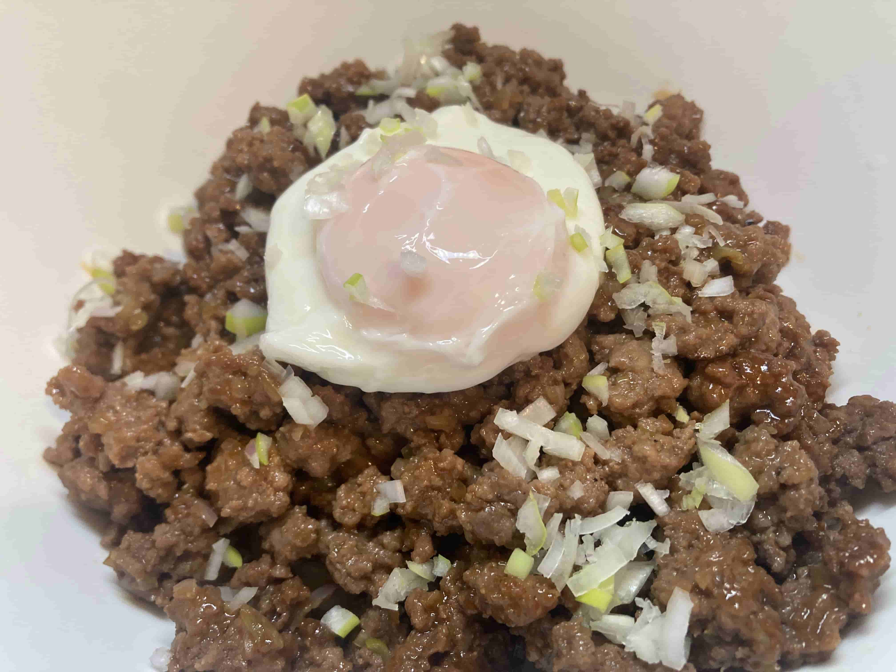

# How to Make Macanese Saucy Minchi Rice

This is a classic Macanese-Portuguese fast food dish (minchi): minced beef that's tender and savory, coated in a rich sauce and runny egg, rich and irresistible when mixed into rice. Ground beef provides high-quality protein, and with egg and onion it's balanced and filling. The steps are simple and easy, especially good for beginners, taking only about 30 minutes from prep to plate.

Estimated difficulty: ★★

Estimated calories: 1011 kcal

## Ingredients and Tools

- Ground beef (can be replaced with slightly fatty ground pork)
- Onion
- Egg
- Butter (can be replaced with ordinary cooking oil)
- Green onion (optional)
- Light soy sauce
- Dark soy sauce
- Ketchup
- White sugar
- Cooking wine
- Black pepper
- Starch
- Cooked rice

## Calculation

Before cooking, decide how many portions to make. One portion is just enough for 1 person.

Per portion:

- Ground beef 200g
- Onion half
- Egg 1 (for a poached egg or runny fried egg)
- Light soy sauce 3 tablespoons (1 tablespoon for marinating, 2 tablespoons for the sauce)
- Dark soy sauce half a tablespoon
- Ketchup 2 tablespoons
- White sugar half a tablespoon
- Cooking wine 1 tablespoon
- Starch 1 tablespoon
- Water 50ml

## Steps

1. Put 200g of ground beef in a bowl, add 1 tablespoon of light soy sauce, half a tablespoon of sugar and 2g of black pepper, mix well, and **marinate for 10 minutes**.
2. Dice half an onion finely and set aside.
3. Mix the sauce: in a bowl, add 2 tablespoons of light soy sauce, 2 tablespoons of ketchup, 1 tablespoon of cooking wine, 1 tablespoon of starch, half a tablespoon of dark soy sauce and 50ml of water, stir well and set aside.
4. In another pan, make a poached egg or runny fried egg and set aside.
5. Heat the wok and add 10g of butter. Once melted, add the diced onion and fry over low heat until cooked and fragrant.
6. Add the marinated ground beef and stir-fry with the onion until the beef changes color.
7. Pour in the prepared sauce, sprinkle with 2g of black pepper, and keep stir-frying until the sauce thickens, then turn off the heat.
8. Pour the minchi over hot rice and top with the poached or runny fried egg you made earlier.
9. (Optional) Sprinkle 5g of chopped green onion on top as a garnish.

## Additional Notes

- If you don't have butter, ordinary cooking oil works, but butter adds a distinctive creamy aroma.
- When eating, break the runny yolk and mix it with the beef and rice for the best texture.

If you follow this guide and find problems or possible improvements to the process, please open an Issue or Pull request.
