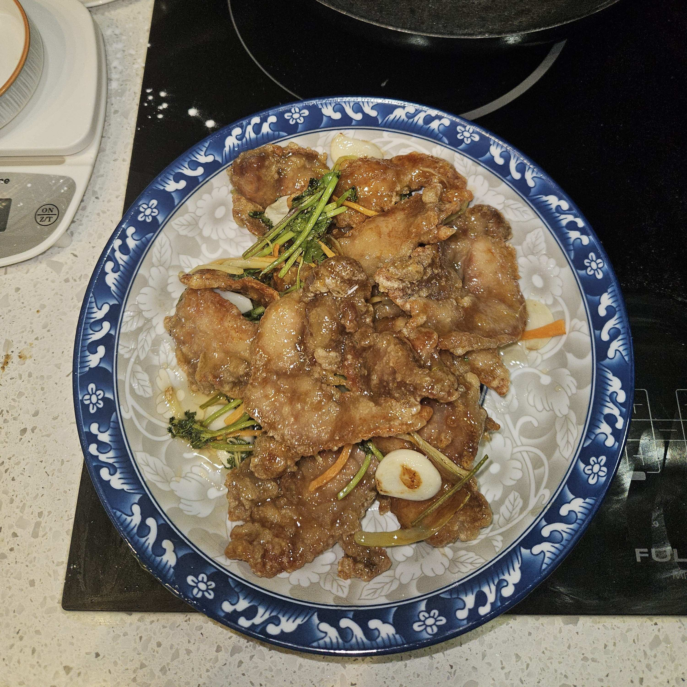

# How to Make Old-Style Guobaorou

Guobaorou is a famous classic dish from northeastern China, originating at the Daotai Mansion in Harbin. White vinegar gives it a distinctive tangy aroma: a crispy shell, tender pork slices, sweet, sour and refreshing. Pork provides high-quality protein, and scallion, ginger and other vegetables whet the appetite and cut the richness. This dish requires mastering the batter, oil temperature and double-frying; the difficulty is medium-high and beginners will need patient practice. From marinating and mixing the batter to frying and serving, it takes about 90 minutes.

Estimated difficulty: ★★★★

Estimated calories: 882 kcal

## Ingredients and Tools

- Pork loin
- Scallion (large, Chinese leek-type)
- Ginger
- Garlic
- Carrot (optional)
- Cilantro
- White vinegar (9-degree vinegar is recommended, to get the distinctive vinegar aroma of old-style guobaorou)
- White sugar
- Cooking wine
- Salt
- MSG
- Potato starch
- All-purpose flour
- Baking soda
- Toasted white sesame seeds (optional)
- Cooking oil

## Calculation

Per portion (about 2 servings):

- Pork loin 300g
- Cooking wine 5ml
- Scallion 50g
- Ginger 30g
- Garlic 3-4 cloves
- Carrot 10g (optional)
- Cilantro 10g
- Baking soda 5g (optional)
- Salt 5g
- Light soy sauce 4g
- White vinegar 55g
- White sugar 65g
- Corn starch 1.5g (potato starch can be used instead)
- Method 1: potato starch 170g
- Method 2: potato starch 210g and all-purpose flour 70g
- Cooking oil 1000ml (for frying)
- Toasted white sesame seeds 5g (optional)

## Steps

1. **Preparing the pork**:
   - Cut the pork loin into even 8mm thick slices and remove the white membrane.
   - Rinse the slices with water to remove blood.
   - Optional: add 5g of baking soda, mix by hand, and let stand for 5 minutes.
   - Rinse 1-2 times with water to remove the excess baking soda.

2. **Marinating the pork**:
   - Add 3g of salt and 5ml of cooking wine to the slices, mix well, and marinate for 15 minutes.

3. **Battering**:
   - **Method 1 (recommended)**:
     - Add plenty of water to 170g of potato starch, stir well, and let stand for 60 minutes until the starch settles and separates.
     - Pour off all the clear water on top, keeping the starch slurry at the bottom (it behaves like a non-Newtonian fluid).
     - Add the pork slices, 5ml of water and 3ml of cooking oil, and mix evenly.
   - **Method 2**:
     - Mix 210g of potato starch and 70g of all-purpose flour.
     - Add water a little at a time, stirring until it's like yogurt: it forms strands when lifted and the batter can mound up in the bowl.
     - Add 10ml of cooking oil and 1g of baking soda and mix well.
     - Put the marinated pork slices into the batter and mix so every slice is evenly coated.

4. **Making the sweet and sour sauce**:
   - Mix 65g of white sugar, 55g of white vinegar, 4g of light soy sauce and 2g of salt evenly and set aside.
   - Optional: 4g of water and 1.5g of corn starch, to make the sauce thicker.

5. **Preparing the vegetables**:
   - Julienne the scallion, ginger and carrot, cut the cilantro into segments, and slice the garlic.

6. **Frying the pork**:
   - **First fry**:
     - Heat the cooking oil in the wok to 170℃ (6/10 heat).
     - Add the pork slices one by one and fry until the coating has set, doesn't stick to chopsticks, the pork floats, and it's pale yellow, about 30 seconds (depending on the size of the slices). Remove and set aside.
   - **Second fry**:
     - Raise the oil to 200℃ (7/10 heat).
     - Add all the pork slices and fry until the shell is golden and crispy, about 30 seconds. Remove and set aside.
   - **Third fry (optional)**:
     - Raise the oil to 220℃ (8/10 heat).
     - Quickly re-fry the pork until it looks golden with a reddish tinge, about 30 seconds (depending on how well your stove holds the oil temperature), for extra crispness. Remove and drain.

7. **Stir-frying**:
   - Leave 20ml of oil in the wok, pour in the sweet and sour sauce, bring to a boil over high heat, and cook until thick, about 30-60 seconds.
   - Optional: pour out half the sauce to make the next tossing step easier
   - Add the fried pork, scallion shreds, garlic slices, carrot shreds and cilantro, pour the sauce you set aside back over, and toss quickly 3 times so the sauce evenly coats the pork.

8. **Serving**:
   - Transfer the guobaorou to a plate, sprinkle with toasted white sesame seeds (optional), and serve.

## Additional Notes

- **Precautions**:
  1. The pork slices should be 8mm thick; too thick or too thin affects the texture.
  2. Control the oil temperature while frying to avoid a shell that's too dark or not crispy—this is very important.
  3. When cooking the sweet and sour sauce, cook until thick but not clumpy, so it doesn't turn into candy syrup.

- **References**:
  - [Laofangu version](https://www.bilibili.com/video/BV19F411b7ME)
  - [Lao Dongbei Meishi version](https://www.bilibili.com/video/BV1wa4y1C7Cd)
  - [Cunlv version](https://www.bilibili.com/video/BV1xy411i7Mi)

If you follow this guide and find problems or possible improvements to the process, please open an Issue or Pull request.
