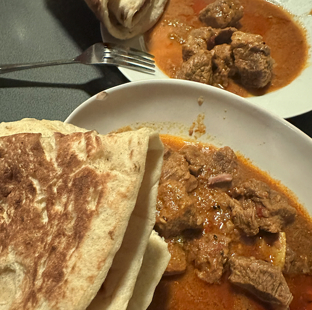
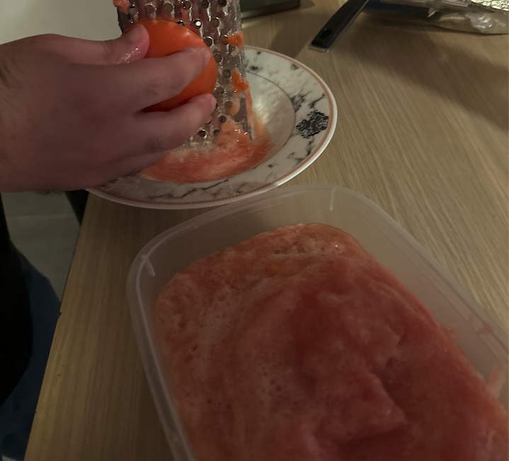
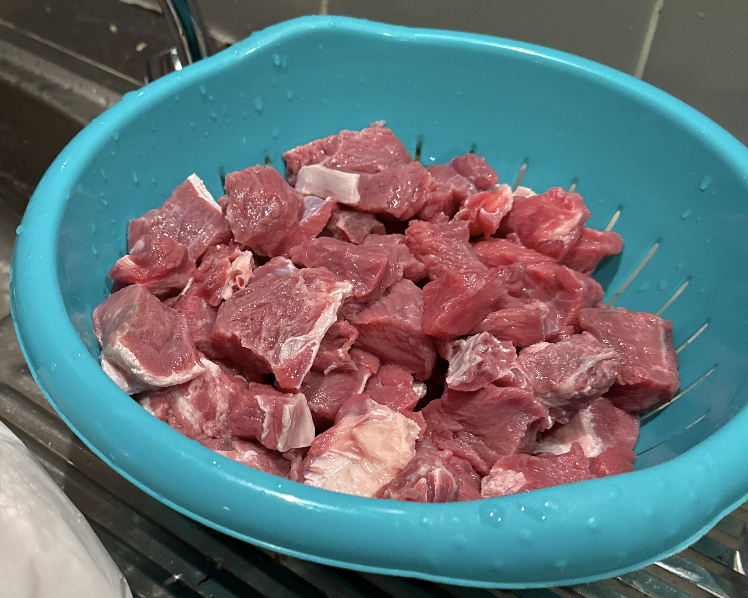
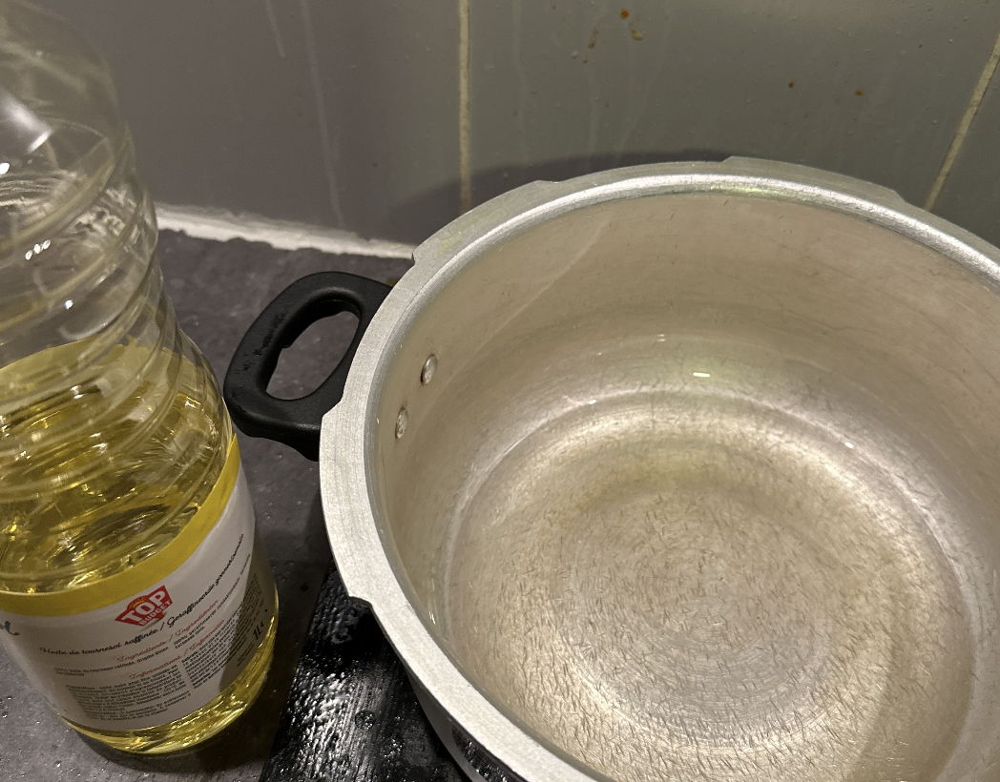
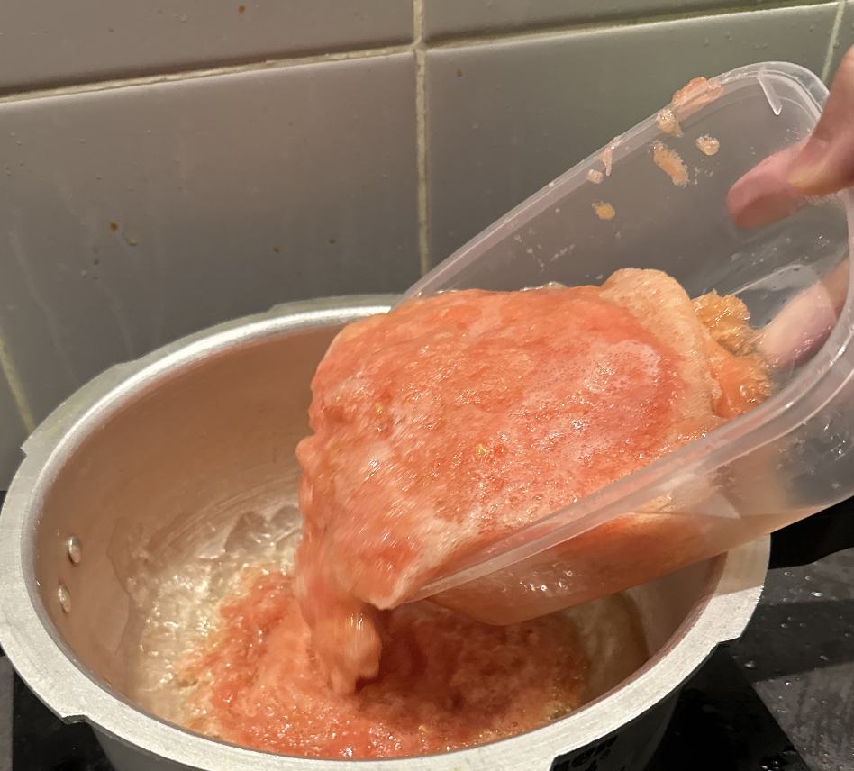
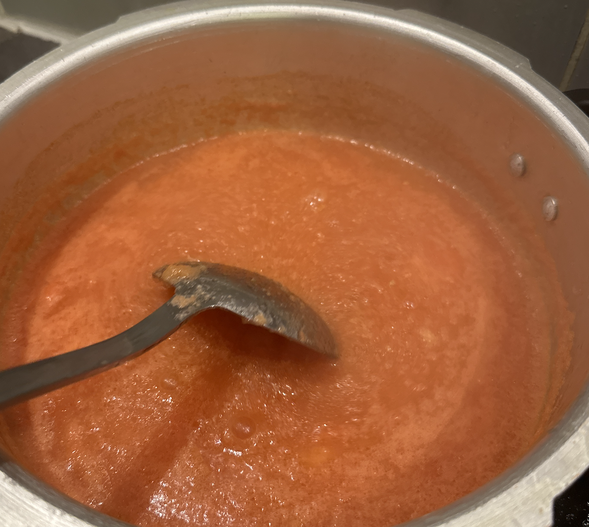

# How to Make Pakistani Beef Curry

This Pakistani-style beef curry is rich and tender, tangy, spicy and appetizing, with a strong aroma of spices. Beef provides high-quality protein, and with tomatoes and yogurt it's nutritionally balanced. It's not complicated, but the slow cooking takes a little patience, so it's great to prepare at leisure on a weekend. In about two and a half hours from start to finish, you'll have a warm pot of exotic deliciousness.

Estimated difficulty: ★★★★★

Estimated calories: 602 kcal

## Ingredients and Tools

- An ordinary wok
- Rice cooker / slow cooker
- Masala powder (Shan brand is an option)
- Beef
- Tomatoes
- Long green peppers (luosijiao)
- Plain yogurt
- Garlic powder
- Ginger powder

## Calculation

The amounts here are based on 1kg of beef, from which you can calculate other quantities. Curry made from 1kg of beef is enough for about 5 people.

Ingredients needed per 1kg of beef:

- Tomatoes 🍅 4
- Long green peppers 2 (large)
- Plain yogurt 1 tub
- Masala powder 1 packet, 50g
- Garlic powder 5g
- Ginger powder 5g

## Steps

1. Cut all the long green peppers into segments and set aside
2. Blend all the tomatoes into a purée and set aside

3. Cut the beef into 2cm cubes, rinse and set aside

4. Pour a layer of oil into the wok (to keep the tomato purée from boiling and evaporating)

5. Pour in the tomato purée and keep stirring for 2-3 minutes, waiting for it to turn redder and redder

6. Add 5g of garlic powder, 5g of ginger powder and 1 packet (50g) of Masala powder and stir well
7. Add the beef and pepper segments and stir well
8. Add 1 tub of yogurt (to thicken the whole sauce) and stir well
9. Transfer everything to the rice cooker / slow cooker, add 250 ml of water, select the stew/slow cook setting, and set the time to 2-3 hours
10. When it's done, open it and check that the beef is tender, and it's ready to eat

## Additional Notes

This dish was learned from a Pakistani friend, with careful notes taken—definitely authentic.

It's usually eaten with roti, naan or rice.

To make chicken karahi, the process is almost the same, except you first fry the chicken in oil with various peppercorns until golden.

If you follow this guide and find problems or possible improvements to the process, please open an Issue or Pull request.
