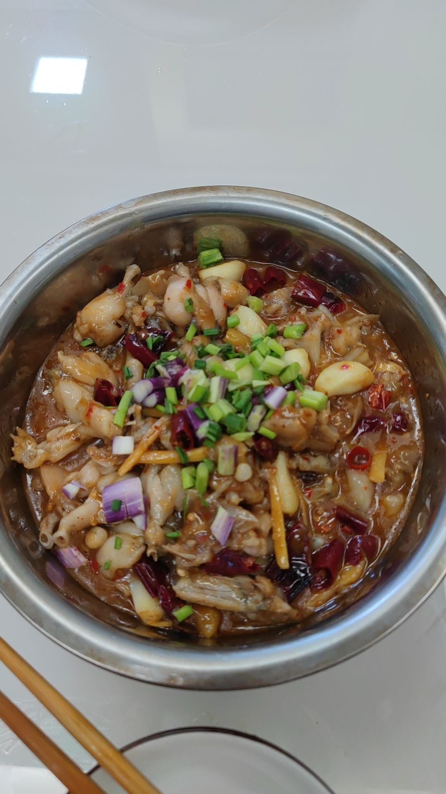

# How to Make Screaming Bullfrog

This dish is fresh, spicy and appetizing, with smooth, springy frog meat—a typical Sichuan home-style dish. Bullfrog is high in protein and low in fat, and paired with fermented ingredients like pickled ginger and pickled chilies, it really stimulates the appetite. The method is fairly direct, but you need to pay a little attention to oil temperature and seasoning ratios. Beginners can usually finish it in 1 to 2 hours.

Estimated difficulty: ★★★★

Estimated calories: 1643 kcal

## Ingredients and Tools

- Bullfrog meat
- Pickled ginger
- Pickled chilies
- Pickled wild chilies (yeshanjiao; dried red chilies can be used instead)
- Green and red chili peppers
- Garlic
- Doubanjiang (Pixian doubanjiang recommended)
- Salt
- Ground pepper
- Potato starch (dry starch also works)
- Beer (Snow beer recommended)
- Cooking wine
- Green Sichuan pepper oil (optional)
- Lard (optional)
- Chopped green onion

## Calculation

1 portion

Per portion:

- Bullfrog pieces 800g (buy 1.5kg / 3 jin of live frogs; smaller ones are recommended for more tender meat)
- Pickled ginger 20-30 grams (to taste; add more if you like bold flavors)
- Pickled chilies 5-10 grams (depending on your spice tolerance; if you can't handle spice, halve it to 2.5 grams for mild heat)
- Pickled wild chilies 10 grams
- Green and red chili peppers 20 grams
- Garlic 30-50 grams (adjust to taste, but preferably no less than 30 grams)
- Doubanjiang 20-30 grams (30 for bold flavor, 20 grams for something lighter. PS this dish can't possibly be light, haha)
- Salt 15 grams
- Ground pepper 10 grams
- Beer 400-500ml
- Cooking wine 10ml
- Green Sichuan pepper oil 5-10ml
- Potato starch 30 grams (dry starch is an equal substitute)
- Lard 20ml (cooking oil works if you don't have lard)
- Cooking oil 200ml
- Chopped green onion 5 grams

## Steps

1. Rinse the bullfrog meat and drain, add at least 10 grams of salt and at least 50ml of beer, and massage by hand for 5 minutes to remove the frog's fishy smell
2. Then rinse under running water until no more blood or debris comes out, drain, and put in a suitable container to marinate
3. Add 5 grams of salt, 30 grams of potato starch, 10ml of cooking wine and 5 grams of ground pepper, mix evenly by hand, and marinate for 5-10 minutes
4. Cut the pickled ginger, pickled chilies and pickled wild chilies into shreds or slices (depending on your knife skills), cut the green and red chilies into rings, and just peel the garlic
5. Heat the wok, add 200ml of cooking oil (add another 100ml if your wok has a flat bottom), heat to 6/10 heat (small bubbles appear), add the marinated bullfrog and quickly pass it through the oil, removing it after 10 seconds (don't go much over, or the frog meat will turn tough)
6. After removing the frog, drain it, and pour the hot oil from the wok into a bowl, leaving 30ml in the wok, then add 20ml of lard (if you have none, leave 50ml of cooking oil in total in the wok)
7. When the oil reaches 6/10 heat, add the pickled ginger, pickled chilies, pickled wild chilies and garlic and fry until fragrant, add 20 grams of doubanjiang and stir-fry over medium heat until the oil turns red (within 30 seconds), then pour in 400ml of beer
8. Then add the fried frog, pushing and turning it with a spoon rather than stirring hard, add 5 grams of ground pepper and 5ml of green Sichuan pepper oil, and braise slowly over medium heat for 3 minutes
9. Turn up the heat and reduce the sauce on high for half a minute, add the green and red chili rings, cook another 10 seconds and get ready to serve
10. Transfer to a bowl, sprinkle with chopped green onion, and dig in!

## Additional Notes

- When draining, you can press with a slotted spoon
- When massaging in the starch, make sure it evenly coats the frog meat

If you follow this guide and find problems or possible improvements to the process, please open an Issue or Pull request.
