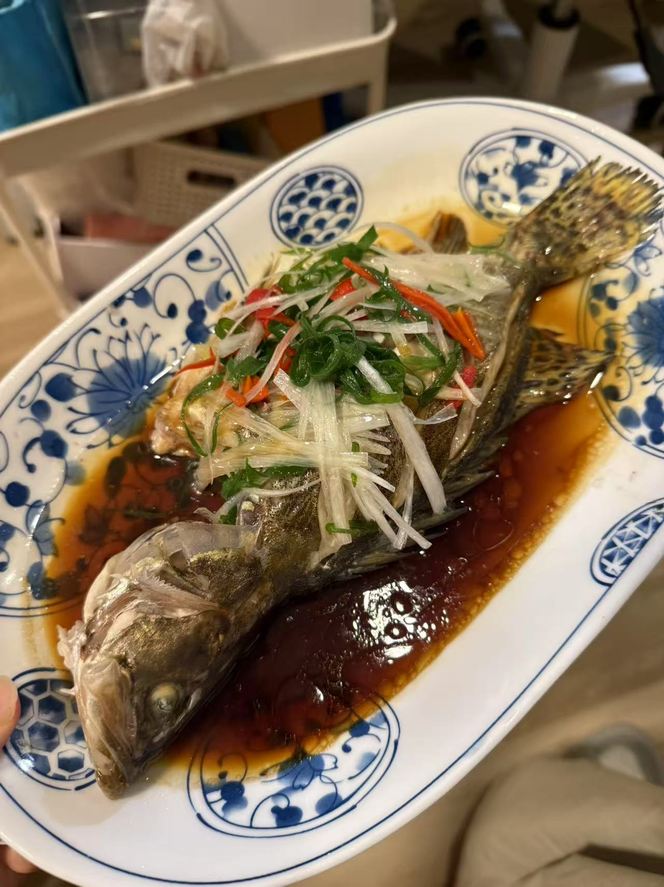

# How to Make Steamed Mandarin Fish

Steamed mandarin fish has delicate, tender meat and a pronounced natural sweetness, a home-style river fish preparation focused on original flavor. Mandarin fish is rich in high-quality protein and various trace elements and is easy to digest. You need to be careful with the fins when preparing it, but the overall steps aren't complicated, and beginners can manage with a bit of care. It takes only about half an hour from prep to plate.

Estimated difficulty: ★★★

Estimated calories: 359 kcal

## Ingredients and Tools

- Mandarin fish (Chinese perch)
- Scallion (large, Chinese leek-type)
- Green onion
- Light soy sauce
- Red chili pepper
- Ginger slices
- Cooking oil

## Calculation

Per portion (about 2 people):

- Mandarin fish 500g
- Scallion 1 section
- Green onion 2 stalks
- Light soy sauce 30g
- Red chili pepper 1
- Ginger 3 slices
- Cooking oil 20ml

## Steps

1. **Preparing the ingredients**:
   - Cut the mandarin fish open from the belly, remove the gills and innards, scale it, and scrape the slime off the skin with a knife (you can ask a friendly vendor to do this)
   - Score the fish, add ginger slices (and a little lard if you have it), and place it on a plate with a chopstick underneath so it heats evenly while steaming
   - Slit the scallion open and remove the core, keeping only the outer two layers
   - Slit the green onions open and set aside
   - Remove the seeds and inner membrane from the red chili and set aside
   - Stack the prepared scallion, green onion and chili together, julienne, and soak in water

2. **Cooking**:
   - Add plenty of water to the pot. When the water is hot, put in the fish, cover, and steam over high heat for 8 - 10 minutes. The key to steaming fish, in four words: plenty of steam, strong fire
   - While the fish steams, heat oil in another pan until it smokes
   - When steaming is done, pour off the steaming liquid, remove the ginger slices, put the julienned aromatics on top, and pour the hot oil over
   - Pour on light soy sauce or seasoned soy sauce for fish, and serve

## Additional Notes

- **Precautions**:
  1. The dorsal fins of mandarin fish can injure you, so be careful when handling it; it's best to cut them off with scissors
  2. Adjust the steaming time to the size of the fish; the key to steaming fish is lots of water, plenty of steam and strong heat

If you follow this guide and find problems or possible improvements to the process, please open an Issue or Pull request.
