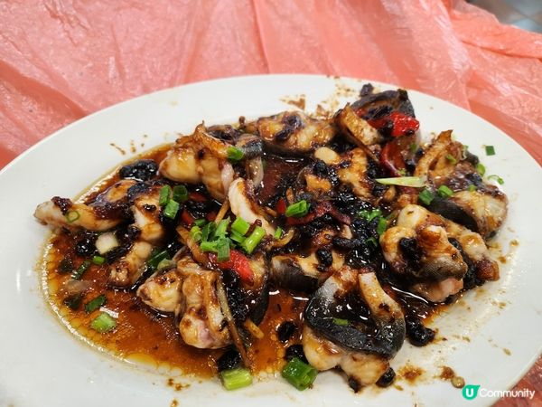

# How to Make Steamed White Eel with Black Bean Sauce

Steamed white eel with black bean sauce is a classic Cantonese steamed dish: the savory aroma of fermented black beans and garlic soaks into the fish, which is tender, smooth and delicious. White eel is rich in high-quality protein and various unsaturated fatty acids and is nourishing. The steps are clear, but handling raw fish and getting the timing right is a bit challenging, so it suits cooks with some basics. It takes about 30 minutes from prep to table.

Estimated difficulty: ★★★

Estimated calories: 472 kcal

## Ingredients and Tools

- White eel (Japanese eel)
- Fermented black beans (douchi)
- Garlic
- Ginger
- Green onion
- Light soy sauce
- Dark soy sauce
- Sugar
- Sesame oil
- Potato starch (optional)
- Red chili pepper (optional, for garnish)

### Tools

- Steamer or electric steam oven
- Heat-resistant plate (suitable for steaming)
- Knife and cutting board
- Small bowl (for mixing the sauce)

## Calculation

One serving

Per portion:

- White eel 250g (about one small eel, gutted and cut into pieces)
- Fermented black beans 1 tablespoon
- Garlic 2 cloves (minced)
- Ginger 3 slices (julienned)
- Green onion 1 stalk (cut into segments or julienned)
- Light soy sauce 1.5 tablespoons
- Dark soy sauce 0.5 teaspoon
- Sugar 0.5 teaspoon
- Sesame oil 0.5 teaspoon
- Potato starch 1 teaspoon (optional, for marinating)
- Water 1 tablespoon (for the sauce)
- Red chili pepper 10g (julienned, for garnish)

## Steps

1. **Checking and cleaning the eel**:
   - When buying, ask the fishmonger to gut it, scrape off the slime and cut it into pieces about 5 cm long.
   - At home, check the eel and rinse it clean, making sure no slime or debris remains.
   - Optional: rub the eel pieces gently with 3g of salt and 1 teaspoon of starch, marinate for 5 minutes, then rinse clean; this removes fishiness and makes it more tender and smooth.

2. **Making the sauce**:
   - In a small bowl, mix 1 tablespoon of black beans, 2 cloves of minced garlic, 1.5 tablespoons of light soy sauce, 0.5 teaspoon of dark soy sauce, 0.5 teaspoon of sugar, 0.5 teaspoon of sesame oil and 1 tablespoon of water, and stir well.
   - If you like a richer black bean sauce, add another 0.5 tablespoon of black beans.

3. **Arranging**:
   - Lay the cut eel pieces flat on the heat-resistant plate, overlapping as little as possible.
   - Sprinkle the ginger shreds evenly over the eel.
   - Pour the sauce evenly over the eel.

4. **Steaming**:
   - Add water (500ml) to the steamer or electric steam oven and bring to a boil.
   - Put the plate of eel in the steamer and cover.
   - Steam over medium-high heat for about 8-10 minutes (adjust for the size of the eel pieces), until the eel is cooked through but not overcooked (the meat turns white with no blood).

5. **Garnishing and serving**:
   - When done, take it out and sprinkle with green onion shreds and red chili shreds (optional) as garnish.
   - You can drizzle with hot sesame oil to boost the aroma.
   - Serve hot with white rice.

## Additional Notes

- **Precautions**:
  - Make sure the eel is fresh; buy live fish for more tender meat.
  - You can ask the fishmonger to cut the pieces to a specific length (about 5 cm is ideal) for easier steaming and eating.
  - Don't steam too long, or the eel will become tough.

- **Variations**:
  - Add chili or XO sauce for extra heat and depth.
  - For an even softer texture, add rice wine when marinating.

If you follow this guide and find problems or possible improvements to the process, please open an Issue or Pull request.
