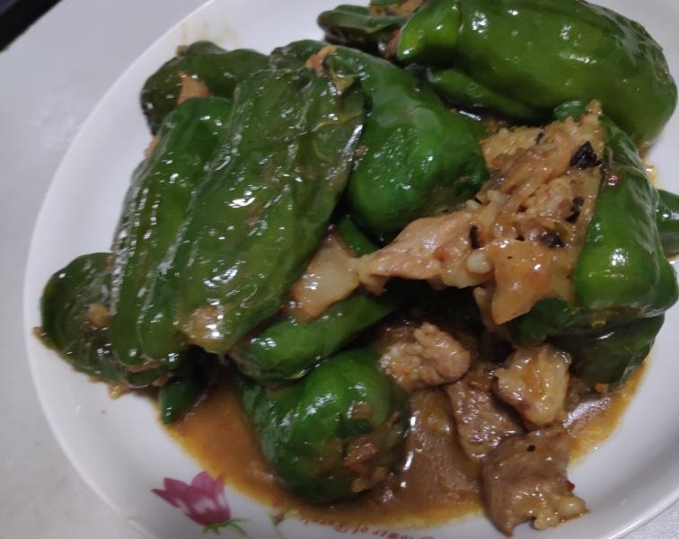
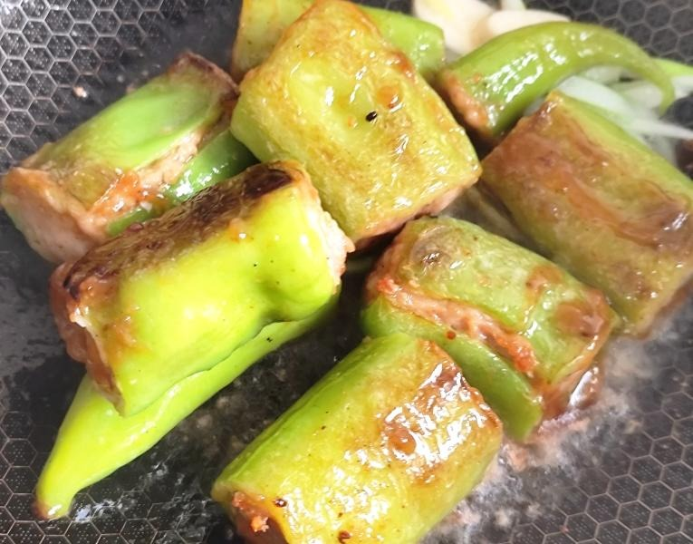
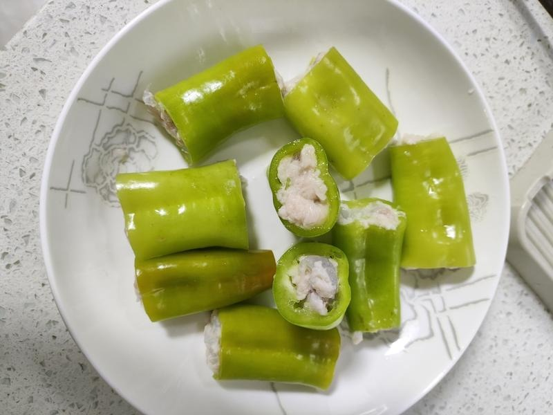

# How to Make Stuffed Green Peppers

This classic Guangxi home-style dish wraps seasoned meat filling or shrimp paste in green peppers, fries them until the skin wrinkles into a "tiger skin", then braises them in sauce. The fresh aroma of the peppers blends with the savory filling, salty and slightly spicy, very good with rice. Pork and shrimp provide high-quality protein, and green peppers are rich in vitamin C for balanced nutrition. Stuffing takes a little patience, but the overall process is clear; following the steps, it's usually done in 30 minutes.

Estimated difficulty: ★★★

Estimated calories: 1403 kcal

## Ingredients and Tools

- Green peppers (6-8; choose straight, thick-fleshed ones, not bell peppers)
- Pork (250g; front shoulder with a 3:7 fat-to-lean ratio is best)
- Green onion (2 stalks)
- Ginger (1 small piece)
- Light soy sauce
- Dark soy sauce
- Salt
- Cooking oil
- Starch (optional, for coating the inside of the peppers to help the filling stick and for thickening the sauce)
- Garlic (optional, 3-4 cloves)
- Oyster sauce (optional)
- Cooking wine (optional)
- Egg (optional)
- Ground white pepper (optional)
- White sugar (optional)

## Calculation

Per portion:

- Green peppers 8 (about 400g; choose straight, thick-fleshed long peppers)
- Pork filling 250g (3:7 fat to lean)
- Green onion 2 stalks (about 30g)
- Ginger 1 small piece (about 10g)
- Light soy sauce 30ml (15ml for the filling, 15ml for the sauce)
- Dark soy sauce 5ml
- Salt 3g
- Cooking oil 30ml
- Starch 10g (optional; 5g for coating the inside of the peppers, 5g for the thickening slurry)
- Garlic 4 cloves (optional, about 15g)
- Oyster sauce 10ml (optional)
- Cooking wine 10ml (optional)
- Egg 1 (optional)
- Ground white pepper 2g (optional)
- White sugar 5g (optional)

## Steps

### Preparing the Filling

1. Rinse the pork and mince it (or use a meat grinder), mince the ginger, and chop the green onion
2. Add the minced ginger, chopped green onion, 15ml of light soy sauce, 5ml of dark soy sauce and 3g of salt to the pork and mix well
3. Optionally add: 10ml of cooking wine, 10ml of oyster sauce, 1 egg, 5g of starch, 2g of ground white pepper, 5g of sugar
4. Stir the filling in one direction until sticky and cohesive, and marinate for 10 minutes

### Preparing the Peppers

1. Wash the peppers and remove the stems. Carefully scoop out the seeds and white pith with chopsticks, keeping the peppers whole
2. Optionally sprinkle about 5g of dry starch inside the peppers and shake to coat evenly; this helps the filling stick

### Stuffing

1. Stuff the marinated filling into the peppers with chopsticks or a piping bag, filling them as much as possible but not too tightly, so they don't split
2. Set aside once all are stuffed

### Mixing the Sauce

1. In a bowl, add 15ml of light soy sauce, 5ml of dark soy sauce and 100ml of water, and stir well
2. Optionally add 5g of starch to make the sauce thicker

### Frying and Braising

1. Heat the wok, add 30ml of cooking oil, and when the oil reaches 5/10 to 6/10 heat, add the stuffed peppers (meat side down first)
2. Fry slowly over medium-low heat, turning so all sides of the peppers wrinkle and blister like tiger skin, then take them out
3. Leave some oil in the wok, and optionally fry minced garlic until fragrant
4. Pour in the prepared sauce, bring to a boil, then add the fried peppers
5. Turn to medium-low heat, cover and braise for 5-8 minutes, until the sauce thickens and the peppers soften
6. Remove the lid and reduce over high heat until the sauce is glossy and coats the peppers, then plate

### Shrimp Paste Fork Version

Shrimp paste-stuffed green peppers are also common in Guangxi—an orthodox way to eat them, not a heretical hack~

1. Devein 250g of shrimp and smash into a paste with the back of a knife (keep some chunkiness for better texture; or just buy ready-made shrimp paste in the triangular piping-bag packs and squeeze it straight in)
2. Season the shrimp paste: 5g of minced ginger, 2g of salt, 5g of starch, 10ml of light soy sauce
3. Optionally add: 5ml of cooking wine, 1g of ground white pepper, half an egg white
4. Stir in one direction until the shrimp paste is cohesive, and marinate for 10 minutes
5. The stuffing, frying and braising steps are the same as the pork version
6. Shrimp paste cooks quickly, so you can shorten the braising time to 4-5 minutes

## Additional Notes

- Straight peppers are easier to stuff than curved ones, and thick-fleshed long peppers taste better than thin-skinned ones
- Stirring the filling in one direction makes it cohesive and springier
- Coating the inside of the peppers with dry starch is the key to keeping the filling from falling out while frying
- Frying until blistered like tiger skin is the source of the flavor—don't skip it
- Adjust the sauce to your taste; for more heat, add Guilin chili sauce
- Shrimp paste and pork filling can be mixed in any ratio: shrimp adds sweetness, pork adds rich fattiness
- The sauce is excellent over rice, so don't reduce it too much

If you follow this guide and find problems or possible improvements to the process, please open an Issue or Pull request.
