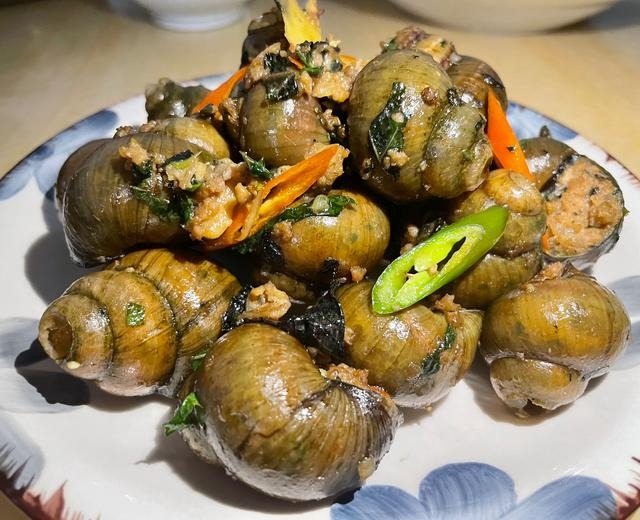
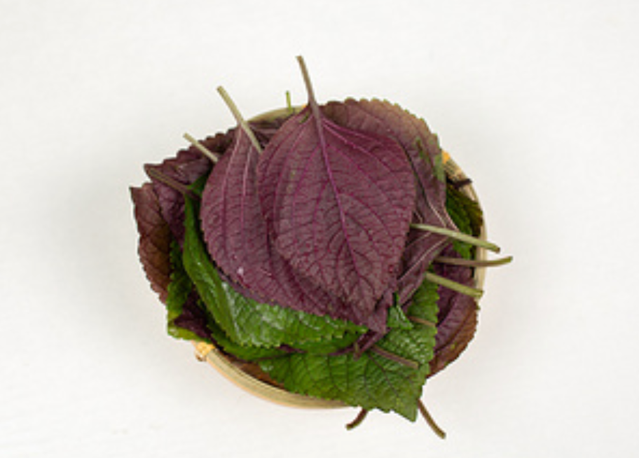
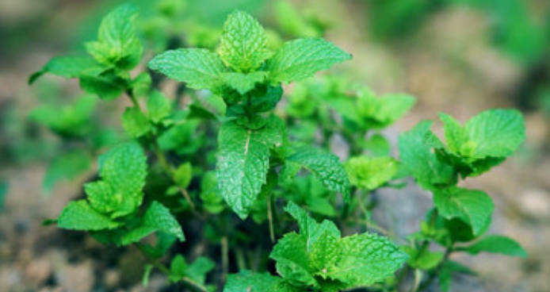

# How to Make Stuffed River Snails

Stuffed river snails (tianluo niang) are the first of Yangshuo's "eighteen stuffed dishes": the snail meat is chewy and firm, the pork tender and smooth, with the fresh aroma of perilla and mint. It was featured in *A Bite of China 2*. It's rich in protein and various trace elements, and the snail meat and pork complement each other nutritionally. There are quite a few steps, which is a challenge for beginners, and the snails need half a day to purge sand in advance. The actual cooking takes about 40 minutes, a great project for the whole family on a holiday.

Estimated difficulty: ★★★★

Estimated calories: 533 kcal

## Ingredients and Tools

- Large river snails (ping-pong ball size, about 20-25; buy them in the morning and let them purge sand all afternoon)
- Pork (250g; front shoulder with a 3:7 fat-to-lean ratio is best)
- Fresh mint leaves (a small handful—the finishing touch)
- Perilla leaves (a small handful—a perfect match for snails)
- Ginger (1 small piece)
- Green onion (2 stalks)
- Guilin Sanhua liquor
- Light soy sauce
- Salt
- Cooking oil
- Sour bamboo shoots (optional, 50g)
- Garlic (optional, 4-5 cloves)
- Dried chili peppers (optional, 3-4)
- Oyster sauce (optional)
- Starch (optional)
- Ground white pepper (optional)

## Calculation

Per portion (2-3 people):

- Large river snails 20 (about 1000g)
- Pork 250g
- Fresh mint leaves 10g
- Perilla leaves 10g
- Ginger 1 small piece (about 15g)
- Green onion 2 stalks (about 30g)
- Guilin Sanhua liquor 15ml
- Light soy sauce 30ml (15ml for the filling, 15ml for the braising liquid)
- Salt 5g
- Cooking oil 30ml
- Sour bamboo shoots 50g (optional)
- Garlic 5 cloves (optional, about 20g)
- Dried chili peppers 4 (optional)
- Oyster sauce 10ml (optional)
- Starch 10g (optional)
- Ground white pepper 2g (optional)

## Steps

### Purging Sand (Half a Day Ahead)

1. Buy the snails in the morning, put them in a basin of clean water, and let them purge sand all afternoon
2. A few drops of sesame oil (or wasabi~) in the water speeds up purging

### Preparing the Snails

1. Scrub the snail shells clean with a brush (this can take a while)
2. Use pliers or a cleaver to cut off the tail end of each snail (about 1/3 to half)
3. Boil a large pot of water, and once boiling, blanch the snails for 1-2 minutes (not too long, or the meat will toughen)
4. Take them out and use a toothpick to pick out the meat, removing the operculum (lid) and the black gut
5. Rinse the shells clean, shake dry, and set aside

### Making the Filling

1. Rub the snail meat with salt to clean it, then chop into small pieces (not into a paste—keeping it chunky gives it chew)
2. Mince the pork
3. Chop the mint and perilla leaves, mince the ginger, and chop the green onion

4. Put the chopped snail meat, minced pork, chopped mint, chopped perilla, minced ginger and chopped green onion in a bowl
5. Add 15ml of Sanhua liquor, 15ml of light soy sauce and 3g of salt
6. Optionally add: 10ml of oyster sauce, 2g of ground white pepper, 10g of starch
7. Stir in one direction until the filling is sticky and cohesive
8. To save effort, you can put everything above straight into a meat grinder.

### Stuffing

1. Use chopsticks to stuff the filling into the snail shells, packing them as full and tight as possible without cracking the shells
2. Stuff all the snails in turn

### Braising

1. Heat the wok, add 30ml of cooking oil, and optionally fry the sour bamboo shoots and dried chilies until fragrant
2. Pour in about 300ml of water or stock, add 15ml of light soy sauce and 2g of salt, and bring to a boil over high heat
3. Put the stuffed snails in the wok, cover, and braise over medium-low heat for 10 minutes
4. Don't stir often while braising; wait until the filling is 60-70% cooked and set before turning gently
5. Remove the lid, add the remaining fresh mint and perilla leaves, and braise for another 2-3 minutes
6. Reduce the sauce over high heat until thick, and serve

## Additional Notes

- How to eat: first suck the broth out of the shell, then pick out the filling with a toothpick or suck it out hard—"lips on the shell, suck hard"
- The best ratio of snail meat to pork is 1:1
- Mint is the essence of this dish, and perilla with snails is a perfect match; you need at least one of the two
- If you don't have Sanhua liquor, use cooking wine instead, but the flavor will suffer
- Keep the blanching time short; too long and the snail meat gets tough and hard
- Pairing it with ice-cold Liquan beer is the standard local way to eat it in Yangshuo
- Reference: [Yangshuo stuffed river snails - Baidu Baike](https://baike.baidu.com/item/%E9%98%B3%E6%9C%94%E7%94%B0%E8%9E%BA%E9%85%BF/3035090)

If you follow this guide and find problems or possible improvements to the process, please open an Issue or Pull request.
