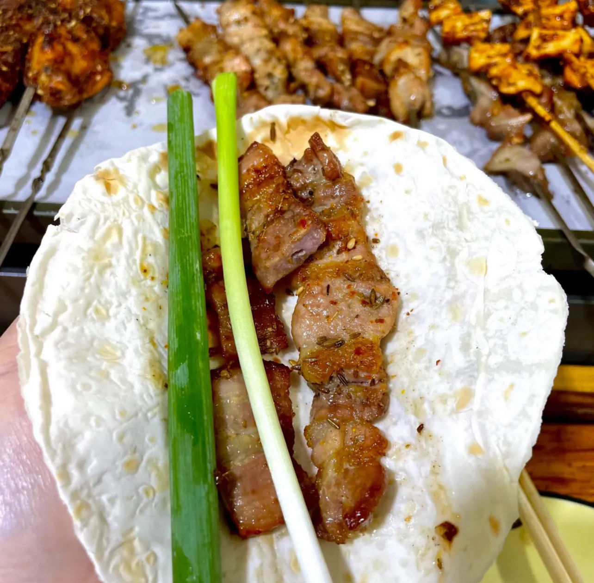

# How to Make Zibo Barbecue

This is a specialty barbecue from Zibo in Shandong. Its distinctive way of eating—grilled meat rolled in a small pancake with scallion—blends the aromas of meat, sauce and scallion for layered flavors. Pork belly is rich in high-quality protein and fat, scallion provides dietary fiber, and the small pancakes give a quick energy boost. You need to control the charcoal heat and how you turn the skewers, which is a bit challenging for beginners. It takes about 40 minutes in total.

Estimated difficulty: ★★★★

Estimated calories: 650 kcal

## Ingredients and Tools

- Pork belly
- Small thin pancakes (store-bought)
- Scallion (large, Chinese leek-type)
- Sesame paste
- Sweet bean sauce
- Sesame salt
- Barbecue grill
- Grill grate
- Charcoal or gas

## Calculation

Each portion is for 1 person; scale up proportionally for more people.

Per portion:

- Pork belly 200g
- Small thin pancakes 5
- Scallion 1 stalk (about 100g)
- Sesame paste 20g
- Sweet bean sauce 15g

## Steps

1. Cut the pork belly into pieces no more than 2cm thick and thread them onto skewers. (Marinating the pork beforehand makes it taste even better)
2. Cut the scallion into 5cm segments and set aside
3. Thin the sesame paste with 10ml of warm water and mix evenly with the sweet bean sauce. Set aside (you can use "sesame salt" instead)
4. Light the charcoal and wait until it's **glowing red with no open flame** (about 15 minutes)
5. Lay the pork skewers evenly on the grate and grill until *the bottom is golden and releasing fat*, then flip
6. Grill for another 2 - 3 minutes, until *golden on both sides and slightly charred at the edges*, then take them off
7. Lay a small thin pancake flat and spread it with 3 - 4g of the mixed sauce
8. Add the grilled pork and 1 - 2 scallion segments, roll it up, and eat

## Additional Notes

- When slicing the pork belly, it's easier to cut if you freeze it for 30 minutes first.
- Charcoal gives better flavor than gas; use wood charcoal if you can.
- Adjust the ratio of sesame paste to sweet bean sauce to taste, or use sesame salt instead.

If you follow this guide and find problems or possible improvements to the process, please open an Issue or Pull request.
