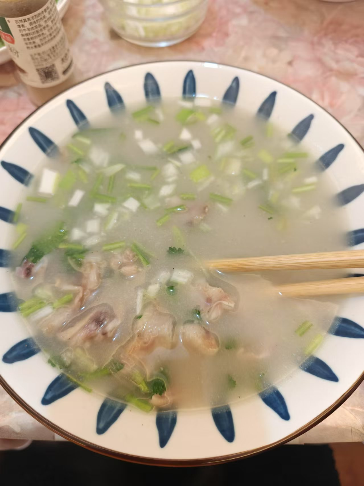

# How to Make Lamb Soup

Lamb soup is a warming home-style soup with a milky white broth and tender meat, with the fresh aroma and slight heat of scallion and white pepper. It's rich in protein, calcium, iron and other nutrients, and is said to warm the stomach and spleen and fend off the cold. The steps are simple and beginners can master them easily. The whole cooking process takes about 30 minutes.

Estimated difficulty: ★★★

Estimated calories: 599 kcal

## Ingredients and Tools

- Lamb or lamb offal
- Cooking oil
- Cooking wine
- Scallion (large, Chinese leek-type)
- Ground white pepper
- Salt
- Ground cumin (optional)
- Cilantro (optional)

## Calculation

Per portion:

- Lamb 300g
- Cooking oil 10ml
- Cooking wine 20ml
- Scallion 50g
- Boiling water 1000ml
- Ground white pepper 1g
- Salt 5g
- Ground cumin 1g
- Cilantro 20g

## Steps

1. Cut the lamb into pieces 5cm long and 0.5cm wide
2. Cut the scallion into small segments
3. Put the lamb in a pot with 1000ml of room-temperature water, the cooking wine and the scallion
4. After boiling for 2 minutes, take out the lamb, rinse with room-temperature water, and drain
5. Heat the pot and add the cooking oil, add the lamb, and stir-fry for 2 minutes until lightly browned on the surface
6. Add the boiling water and turn to high heat
7. After 5 minutes, add the ground white pepper and salt and keep boiling for 5 minutes
8. After serving, add the cilantro and ground cumin and stir well

## Additional Notes

- When adding the boiling water, make sure the heat is on high, so the fat emulsifies better with the broth

If you follow this guide and find problems or possible improvements to the process, please open an Issue or Pull request.
