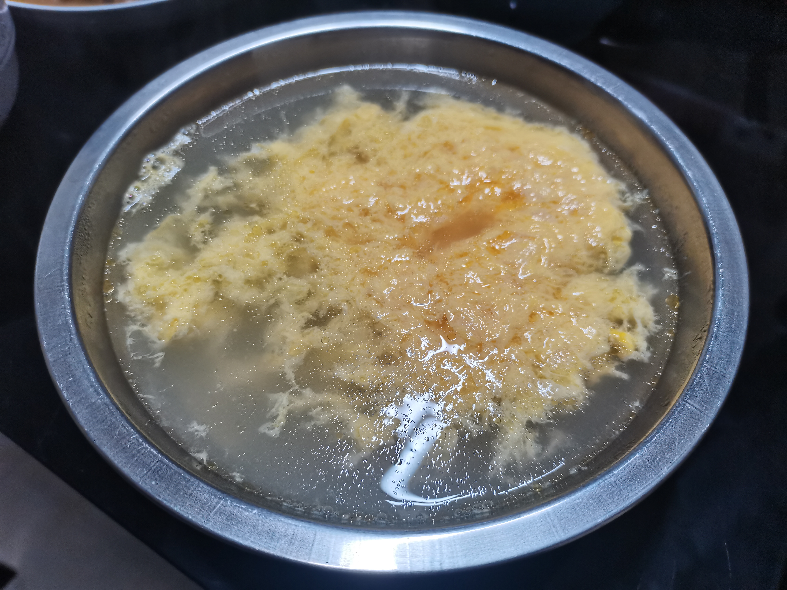

# How to Make Zhuque Egg Soup

Zhuque soup is a quick home-style soup from eastern Henan, smooth and sweet with the mellow aroma of sesame oil. Eggs provide high-quality protein. It's very simple—just boil water and pour it over beaten egg—and it's on the table in under ten minutes. It's also said to have a cooling effect.

Estimated difficulty: ★

Estimated calories: 168 kcal

## Ingredients and Tools

- Egg
- Sesame oil
- White sugar
- Water

## Calculation

For 1 person:

- 1 egg
- 500ml water
- 20 grams white sugar (adjust to taste)
- 2ml sesame oil

## Steps

1. Beat the egg in a bowl, then add the sesame oil.
2. Once the water boils, while it's still at a rolling boil, quickly pour it into the bowl with the egg.
3. Add the sugar.

## Additional Notes

- The egg must be well beaten, and the water must be poured in while at a rolling boil, or the soup may turn cloudy and affect the texture
- This is the eastern Henan method; other regions add salt instead of sugar for a different taste—adjust to your preference
- This soup is a miracle cure for "excess internal heat"!

If you follow this guide and find problems or possible improvements to the process, please open an Issue or Pull request.
