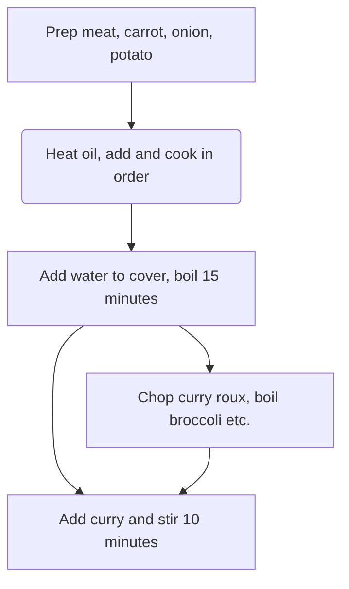
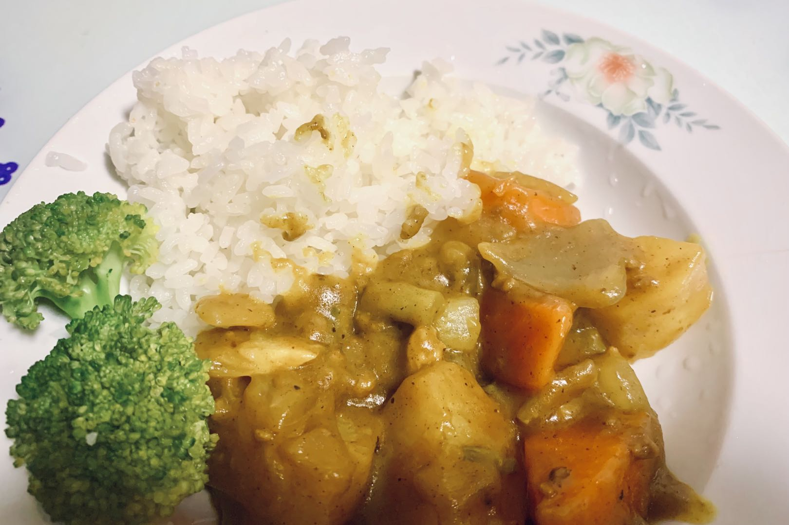

# How to Make Japanese Curry Rice

Japanese curry rice is a rich, mellow home-style Japanese dish, seasoned with curry roux and made with potatoes, carrots, onions and meat: smooth, velvety, spicy and slightly sweet. It's rich in protein, carbohydrates and various vitamins, providing plenty of energy. The method isn't complicated overall, but you need to master the heat and stirring, so it suits people with a little cooking experience. It takes about 1 hour from prep to serving, and tastes even better after chilling.

Estimated difficulty: ★★★★

Estimated calories: 730 kcal

## Ingredients and Tools

### Main Ingredients

- Curry roux blocks (House Foods recommended)
- Potatoes
- Carrot
- Onions
- Meat (pork, chicken or beef)
- Garlic

### Additional Ingredients

Extra ingredients for garnish, optional

- Broccoli/cauliflower (boiled in water)
- Bacon (ready-to-eat)
- Fried egg or [Microwave Sunny-Side Up Egg](../breakfast/microwave-sunny-side-up-egg.md)

## Calculation

The amounts of ingredients are proportional to the curry. The calculation uses **half a box of House curry roux (115g)** as an example. Half a box makes about six bowls; the curry tastes even better after being refrigerated, so don't worry about not finishing it alone.

- Onions 2
- Potatoes 2
- Carrot 1
- Garlic 2~3 cloves
- Meat 1kg (2 jin)

## Steps

### 1. Preparing the Ingredients

1. Trim the ends of the carrot, peel, and roll-cut
2. Peel the outer layer of the onions, remove the core, and cut into crescents
3. Peel the potatoes and cut into large chunks
4. Cut the meat into chunks
5. Peel, smash and mince the garlic
6. Chop the curry roux to increase its surface area so it dissolves faster

### 2. Cooking

1. Heat oil in the pot, add the garlic and meat, and **stir-fry quickly** until *the surface of the meat turns white*
2. Add the carrot and **stir-fry quickly** until evenly heated
3. Add the onions and **stir-fry quickly** until *the onions turn translucent*
4. Add the potatoes and keep stir-frying until *they soften* (check with chopsticks)
5. Add water to cover all the ingredients, and once boiling, **wait 15 minutes**
6. Turn off the heat, add the curry roux and stir
7. Once the curry has melted, turn the heat back on and **stir slowly for 10 minutes** to prevent burning
8. Once it *looks thick*, turn off the heat. Done

### 3. Reheating After Chilling

Take out as much of the refrigerated curry as you'll eat each time, reheat, and pour it over [rice](./rice-cooker-rice.md).

1. Microwave: one serving on high for 2-3 minutes
2. Pot: add an extra 50ml of water and keep stirring while heating

## Additional Notes

### Notes

- Step 1-6 can be done while waiting during step 2-5; you can also boil some vegetables in a pot of water or fry an egg during this time.
- Between steps 2-5 and 2-6, watch the water level as it boils. If it drops below 2/3 of the ingredients, add hot water to cover them.

### Flowchart

### Finished Dish

### References

- [World Cuisine Tutorial video on Weibo](http://t.cn/EJ77yFy)

---
If you follow this guide and find problems or possible improvements to the process, please open an Issue or Pull request.
