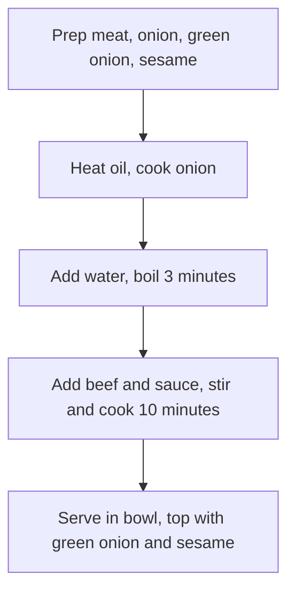

# How to Make Japanese Gyudon (Beef Bowl)

A classic Japanese home-style rice bowl: thinly sliced fatty beef and white onion simmered in a sweet-savory sauce, with tender meat, sweet onion and a rich, flavorful sauce. Beef provides high-quality protein and heme iron, and onion is rich in dietary fiber and various antioxidants. It's not complicated; beginners can easily make it by following the steps. The cooking takes about 30 minutes.

Estimated difficulty: ★★★★

Estimated calories: 774 kcal

## Ingredients and Tools

### Main Ingredients

- Onion (be sure to use a white/yellow-skinned onion, not a red one)
- Thinly sliced fatty beef (hot pot beef slices are fine; you can also use whole-cut beef slices)
- Green onion (pre-cut green onion also works)
- White sesame seeds
- Mirin (a common Japanese seasoning available on major e-commerce platforms; cooking wine can be used instead)

### Additional Ingredients

Extra ingredients for garnish, optional

- [Onsen Tamago](../breakfast/onsen-tamago.md)
- Dashi (broth made from bonito flakes and kombu, for extra savoriness)

## Calculation

The amounts are proportional to the rice. The calculation uses **one cup of rice (160ml)** as an example. That's about two servings; leftovers can be refrigerated, but may not taste as good

- Onion 1
- Fatty beef 250 grams
- Green onion 1~2 stalks
- White sesame seeds 5 grams

## Steps

### 1. Preparing the Ingredients

1. Peel the outer layer of the onion, remove the core, and cut into crescents
2. Wash the green onion and cut into 0.5cm pieces
3. Heat a dry pan and add the white sesame seeds, **shaking the pan back and forth** so they toast evenly until *lightly golden*
4. Blanch the beef for 1 minute, then remove
5. Mix 40g of `mirin` (or 30g of `cooking wine`), 30g of `soy sauce`, 20g of `oyster sauce`, 5g of `sugar` and 5g of `dark soy sauce` (optional, for color) in a bowl to make the `sauce` (you can do this with the bowl directly on a kitchen scale)

### 2. Cooking

1. Heat oil in the pan, add the onion, and **stir-fry quickly** until *the onion turns translucent*
2. Turn the heat down, add 250g of water (or dashi), turn back to high heat and **wait 3 minutes**
3. Add the beef and the `sauce`
4. **Keep turning** all the ingredients for **10 minutes** to keep them from sticking
5. Turn off the heat
6. Serve the beef over [rice](./rice-cooker-rice.md) (be sure to pour some of the sauce over the rice)
7. Sprinkle with chopped green onion and white sesame seeds. Done.

### 3. Reheating After Chilling

Take out as much of the refrigerated gyudon as you'll eat each time, reheat, and put it over [rice](./rice-cooker-rice.md).

1. Microwave: one serving on high for 2-3 minutes
2. Pan: add an extra 50ml of water and **keep turning** while heating

## Additional Notes

```shell
struct Staple{float saltiness;};
struct Staple gyudon
gyudon.saltiness = taste_the_sauce();
while(gyudon.saltiness < expected) add(1 g) soy_sauce; gyudon.saltiness = taste_the_sauce();
```

### Notes

- If you're using fairly good beef, you can skip blanching to keep more of the beef's flavor. Since mirin is added it won't taste gamy, and don't worry about the beef being undercooked—10 minutes of heating will definitely cook it
- If you can, add 15g of `sake`

### Flowchart



### Finished Dish


### References

- [Heshui Yangyang Lab: [Gyudon | Beef Bowl] The authentic Yoshinoya beef bowl recipe](https://www.bilibili.com/video/BV1rK4y1d7Fk)
- [Xia Shu's Kitchen: A heavenly recipe in 60 seconds—delicious beef rice bowl that goes great with rice!](https://www.bilibili.com/video/BV1xu4y1676X)

---
If you follow this guide and find problems or possible improvements to the process, please open an Issue or Pull request.
