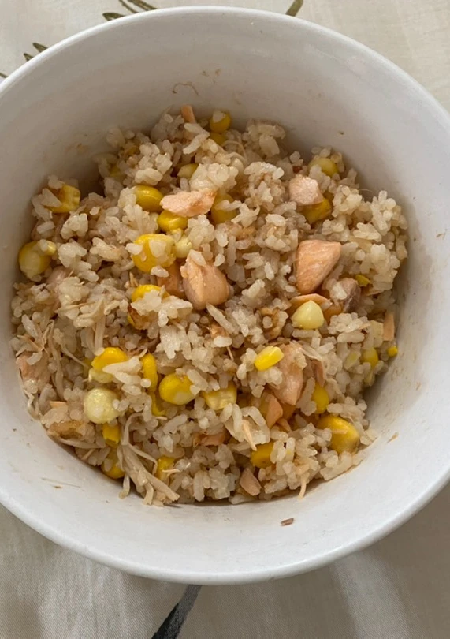

# How to Make Rice Cooker Salmon Rice

This is a home-style dish based on Japanese takikomi gohan: the rice soaks up the aroma of butter and salmon for a rich, savory flavor. Salmon provides high-quality protein and unsaturated fatty acids, and mushrooms add dietary fiber. It's extremely simple—done with one press of the rice cooker button—taking about 45 minutes from prep to serving, perfect for beginners.

Estimated difficulty: ★★

Estimated calories: 889 kcal

## Ingredients and Tools

- Salted butter
- Salmon
- Rice
- Corn (optional)
- Enoki mushrooms (optional)
- Shiitake mushrooms (optional)

### Tools

- Rice cooker

## Calculation

- Rice 50g / person
- Salmon 300g / person
- Water
- Butter 1 tablespoon / person

## Steps

1. Scale and debone the salmon
2. Chop the enoki and shiitake mushrooms
3. Rinse the rice three times
4. Put the salmon, rice and butter in the rice cooker
5. For a richer flavor, add another tablespoon of butter
6. Add water according to the markings on the rice cooker
7. Set the rice cooker to the rice cooking mode and wait about 30 - 45 minutes

## Additional Notes

If you follow this guide and find problems or possible improvements to the process, please open an Issue or Pull request.
