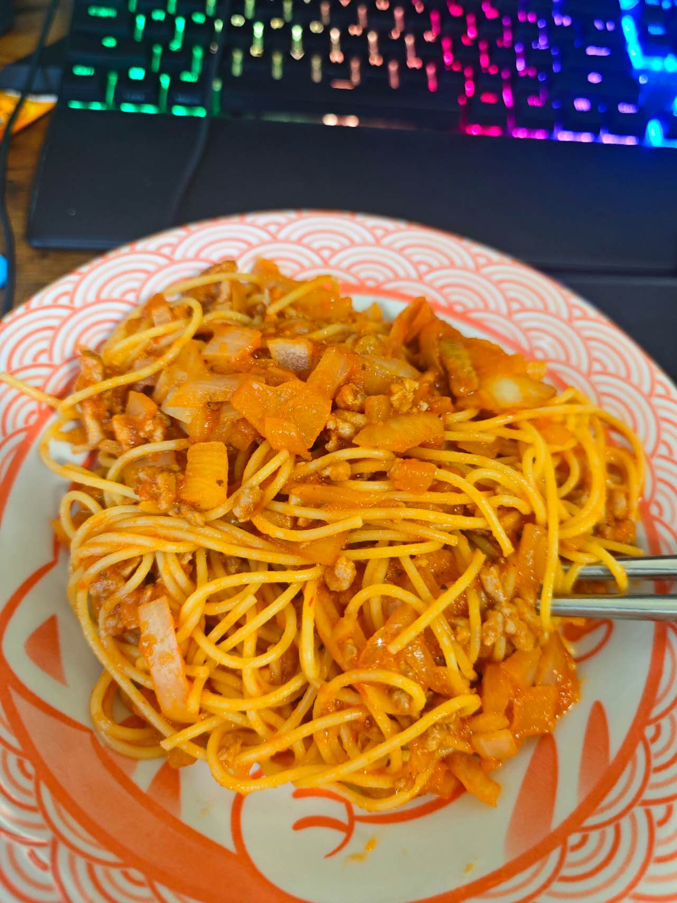
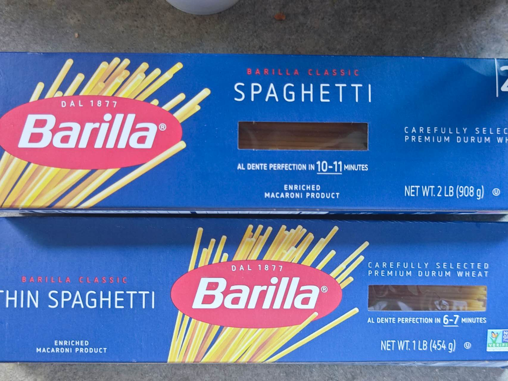
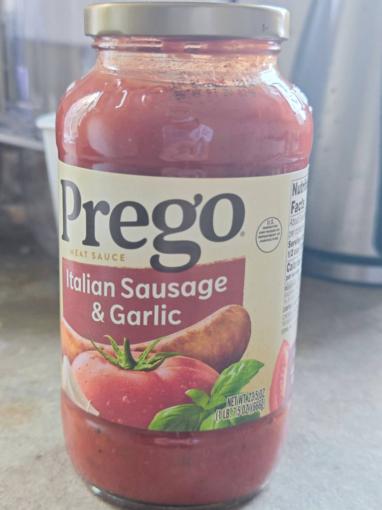

# How to Make Spaghetti Bolognese

Spaghetti Bolognese is a simple, quick home-style Western dish with a rich sauce and chewy pasta, perfect for busy days. Minced meat and onion with ready-made pasta sauce give you a quick dose of protein and carbohydrates, and onion adds dietary fiber. It's very beginner-friendly, needing only simple chopping and frying; once you're used to it, it's on the table in 15 minutes—more satisfying than instant noodles.

Estimated difficulty: ★

Estimated calories: 1199 kcal

## Ingredients and Tools

- Spaghetti
- Pasta sauce
- Minced meat
- White onion (red onion also works)

## Calculation

Before cooking, decide how many portions to make. One portion is just enough for 2 people.

Per portion:

- Spaghetti 180 grams (adjust to appetite)
- Minced meat 80 grams (adjust to appetite)
- Onion, a bit more than half (about 150 grams, usually twice the weight of the meat)
- Pasta sauce 300 grams (adjust as needed)
- Cooking oil 10-15ml

## Steps

1. Add water to a pot, bring to a boil, and add the spaghetti (wait 6 - 12 minutes)
2. While the water boils, you can do the following steps, but keep an eye on the pasta cooking time
3. Dice the onion finely
4. Pour oil into an empty pan and add the diced onion over medium heat
5. Stir constantly, taking care not to burn the onion, until it becomes translucent
6. Add the minced meat and keep stirring (breaking it up) until the meat turns brown
7. Add the pasta sauce and stir briefly
8. Drain the cooked spaghetti and toss it in the meat sauce until evenly mixed (or just pour the sauce over the spaghetti)

## Additional Notes

- Spaghetti comes in many different thicknesses; check the cooking time on the package before boiling
- Pasta sauce isn't ketchup. What we usually call ketchup is tomato sauce for dipping; pasta sauce is also a seasoned tomato sauce, but with different seasonings

If you follow this guide and find problems or possible improvements to the process, please open an Issue or Pull request.
