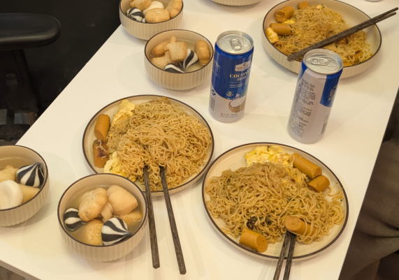

# How to Make Stir-fried Instant Noodles

These stir-fried instant noodles are springy, chewy, savory and well-seasoned—a quick home-style staple adapted from ordinary boiled instant noodles. Eggs and ham sausage add protein and energy. It's simple—just remember to rinse the noodles in cold water to keep their texture—and beginners can make it easily. It's ready in about 15 minutes.

Estimated difficulty: ★★

Estimated calories: 789 kcal

## Ingredients and Tools

* Instant noodles
* Eggs
* Ham sausage (optional)

## Calculation

Before cooking, decide how many portions to make. One portion is just enough for 1 person.

Total:

* Instant noodles: 1 pack per person.
* Eggs: 1 per person.
* Ham sausage: 1 per person.
* Cooking oil: 10 - 18 ml per person.

Use the above to calculate the proportions of ingredients you plan to use.

## Steps

### Preparing the Ham Sausage

1. Tear open the ham sausage wrapper and cut into 1cm pieces.

### Preparing the Noodles

1. Add 1200 ml of water to the pot, or enough to cover the noodle block. Bring to a full boil—don't add the noodles before it boils.
2. Add the noodle block and cook for 45 seconds, stirring to break the noodles apart while cooking.
3. As soon as the noodles have separated, turn off the heat. Don't cook them through!
4. Ladle out 80ml of the hot noodle water and set aside.
5. Separate the noodles from the water. Rinse the noodles under cold water.
6. Drain the noodles. Don't leave them soaking in water for long.

### Preparing the Sauce

1. In a small bowl, squeeze in the instant noodle seasoning packets.

  * Squeeze in all the vegetable packets
  * Squeeze in all the sauce packets
  * Squeeze in 50% - 80% of the powder packet (the whole powder packet makes it very salty)

2. Pour all of the 80ml of hot noodle water from the previous step into the small bowl and stir to make the sauce bowl.

### Preparing the Eggs

1. Crack the calculated number of eggs into a small bowl. Don't add salt! (The eggs will take on the saltiness of the other ingredients in the end)
2. Heat the wok for 20s and add portions * 8ml of oil.
3. Add the bowl of eggs you just prepared. Stir-fry for about 20s until set.
4. Take out the eggs and set aside. No need to wash the wok; usually there isn't much oil left in it.

### Final Steps

1. Reheat the wok for 20s and add oil: portions * 10ml.
2. Add the ham sausage from step one. Stir-fry for 10 seconds.
3. Add the noodles from step two. Stir-fry for 30 seconds.
4. Add the sauce bowl from step three. Stir-fry for 30 seconds.
5. Add the eggs from step four. Stir-fry for 30 seconds.
6. Turn off the heat and plate.

## Additional Notes

* In Beijing, consider adding sesame paste after plating. If the sesame paste is too thick, thin it 1:1 with water.
* You must rinse the noodles in cold water! Cold water instantly strips the gelatinized starch from the surface of the noodles and stops the residual heat from cooking the inside. This is the core principle that keeps the noodles from clumping and sticking to the wok when stir-fried, and keeps them springy.
* Another way to prepare the noodles also keeps them chewy and springy. It takes longer overall, so you can prepare the other ingredients at the same time:
  * Soak: soak the noodle block in cold water for 2 minutes so it fully absorbs water and is moist, then drain (no need to soften).
  * Steam: put the wet noodle block in a steamer and steam on high for 8 minutes after the water boils, then take it out and loosen the noodles (steaming locks in moisture, keeping the noodles springy).

If you follow this guide and find problems or possible improvements to the process, please open an Issue or Pull request.
