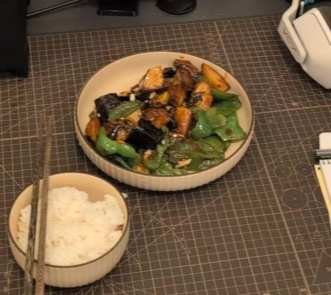

# How to Make Di San Xian (Three Treasures of the Earth)

Di san xian ("three fresh things from the earth") is a classic northeastern Chinese home-style dish: soft eggplant, fluffy potatoes and crisp hot peppers in a savory soy sauce glaze—great with rice. The ingredients provide plenty of vitamins and dietary fiber, and potatoes add satisfying carbohydrate energy. This dish involves deep-frying and quick stir-frying, which takes some technique, so beginners need a little practice. It takes about 40 minutes in total.

Estimated difficulty: ★★★

Estimated calories: 264 kcal

## Ingredients and Tools

- Eggplant
- Potatoes
- Long hot green peppers
- Green onion
- Ginger
- Garlic
- Doubanjiang (chili bean paste)
- Light soy sauce
- Sugar
- Starch

## Calculation

Note: this dish only comes in a version for 2-4 people.

- Eggplant 200g
- Potatoes 150g
- Hot green peppers 3 - 4
- Starch 8g

Use the above to calculate the proportions of ingredients you plan to use.

## Steps

### Preparing the Ingredients

1. Wash the potatoes, eggplant and peppers.
2. Peel the potatoes.
3. Cut the eggplant and potatoes into irregular pieces of about 15g each.
4. Tear the peppers by hand along the grain into pieces about 25% larger than the potato and eggplant pieces.
5. Remove as much water as possible from the surface of the peppers to avoid oil spattering during frying later. Consider using paper towels or air-drying for half an hour.
6. Cut the green onion into 0.5cm pieces, 5g in total. Mince the garlic, 15g in total, split into two portions of 7.5g. Mince the ginger, 5g.
7. In an empty bowl, add 10ml of light soy sauce, 10g of sugar and 8g of starch, add 80ml of water, and stir thoroughly. This is the sauce bowl; set aside.

### Initial Frying

1. Heat the wok and add 150ml of oil.
2. Add the potatoes and fry for about 3-4 minutes, until golden and a chopstick pierces them easily.
3. Take out the potatoes, leaving the oil.
4. Add the eggplant and fry for about 2-3 minutes until about 70% cooked, i.e. softened, slightly charred at the edges and releasing excess oil.
5. Take out the eggplant, leaving the oil. (There may be none left)
6. If there's no more free-flowing oil in the wok, consider adding 15ml more.
7. Add the pepper pieces and fry for about 15 seconds; as soon as the edges blister slightly, take them out immediately. Pour the oil out of the wok.

### Final Frying

1. Reheat the wok and add 15ml of fresh oil.
2. Add 5g of green onion, 5g of ginger and 7.5g of garlic. Fry over medium-low heat until fragrant.
3. Add 15ml of doubanjiang. Turn to low heat and fry until the oil turns red and smells savory.
4. Pour in the sauce bowl. Immediately turn to high heat and stir quickly to avoid burning! After about 10 seconds the sauce will start bubbling and thickening.
5. Immediately add all the prepared potatoes, eggplant and peppers.
6. Toss for 20 seconds so the thick sauce coats the ingredients evenly.
7. Turn off the heat, sprinkle in the remaining 7.5g of garlic, toss evenly, and plate.

## Additional Notes

* Having more sugar than starch is perfectly reasonable. The starch isn't there for flavor; it's just a physical thickener.
* After frying, the eggplant shrinks to about a quarter of its volume. So you may notice that a lot of eggplant goes into the wok and very little comes out. This is normal.
* The peppers may release a burst of water the instant they hit the oil, causing it to spatter. Be sure to hold the wok lid in front of you as a shield and add them carefully.

If you follow this guide and find problems or possible improvements to the process, please open an Issue or Pull request.
