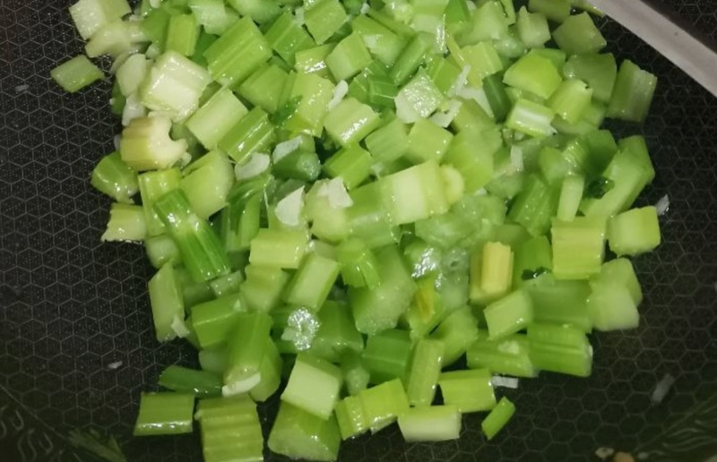

# How to Make Garlic Stir-fried Celery

Garlic stir-fried celery is a crisp, refreshing quick home-style vegetable dish with a strong garlic aroma. Celery is rich in dietary fiber, vitamin K and potassium. The soul of this dish is "crunch": stir-fry over high heat for just half a minute and serve, so it's crisp and juicy when you bite in. It takes only about 10 minutes from prep to plate.

Estimated difficulty: ★★

Estimated calories: 150 kcal

## Ingredients and Tools

* Celery (Chinese celery, xiangqin, is best)
* Lard (you can substitute cooking oil, but lard tastes better)
* Garlic
* Salt

## Calculation

Per portion:

* Chinese celery 300 g (about 2 large handfuls)
* Garlic 4 cloves, minced
* Lard 15 ml
* Salt 2 g

## Steps

1. Pick off most of the celery leaves, keeping only a few tender ones. If the stalks are thick, split them lengthwise so they're an even thickness, then cut into pieces no longer than 5 cm (about the length of your thumb—pieces that are too long can catch in your throat)
2. Mince the garlic and set aside
3. Drain the celery as thoroughly as possible before it goes in the wok—the drier the better
4. Heat the wok, add 15 ml of lard, and when the fat is hot, sprinkle in 2 g of salt first
5. Add the minced garlic and stir-fry over low heat for 10 seconds until fragrant
6. **Turn to high heat**, add the celery, stir-fry quickly for **30 seconds**, and serve immediately
7. Doneness: the celery should look **half-cooked**, bright green, and not wilted—this is when it's crunchiest

## Additional Notes

* Chinese celery (the thin-stalked variety) is best, with the crispest, most tender texture. Regular celery works too, but split thick stalks lengthwise
* **High-heat quick stir-frying is the key**: no more than 1 minute from wok to plate. Cooked longer, the celery turns soft and limp and loses its crunch
* Drain the celery as much as possible before it goes in; too much water lowers the wok temperature, so it ends up "boiled" rather than "stir-fried"
* Lard is more fragrant than cooking oil; if you don't have lard, cooking oil works

If you follow this guide and find problems or possible improvements to the process, please open an Issue or Pull request.
