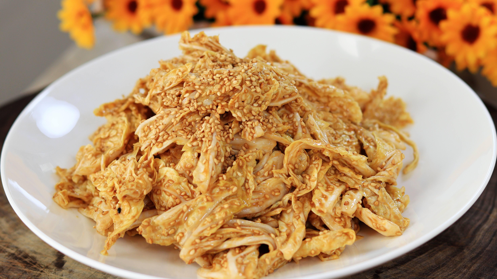

# How to Make Qianlong Cabbage

Qianlong cabbage is a classic Beijing-style cold dish: hand-torn napa cabbage hearts tossed in a thick sesame paste dressing, sweet, tangy, crisp, rich and appetizing. Napa cabbage is rich in vitamins and dietary fiber, and sesame paste brings good fats and calcium—refreshing, cutting richness, and nutritious. No stir-frying or boiling at all—just mix the dressing and toss—so it's very beginner-friendly and usually on the table in 10 minutes.

Estimated difficulty: ★★

Estimated calories: 150 kcal

## Ingredients and Tools

- Napa cabbage (use the yellow inner leaves; winter napa cabbage hearts are best)
- Sesame paste
- Aged vinegar (Zhenjiang black vinegar or Shanxi aged vinegar recommended)
- White sugar
- Sesame oil
- Toasted white sesame seeds (optional, for garnish)

## Calculation

Before cooking, decide how many portions to make. One portion is just enough for 2 people.

Per portion:

- Tender napa cabbage leaves 300g
- Sesame paste 30g (about 2 tablespoons)
- Aged vinegar 45ml (about 3 tablespoons; vinegar to sesame paste about 3:2)
- White sugar 5g (about 1 teaspoon)
- Sesame oil 5ml
- Salt 1g
- Toasted white sesame seeds 3g (optional)

## Steps

1. Use only the tender inner leaves (the yellow part) of the napa cabbage, remove the stems, and tear by hand into pieces about half the size of your palm—**don't cut with a knife** (torn edges are rough and hold the sauce better)
2. Rinse the torn leaves and drain thoroughly; leftover water will keep the sauce from clinging
3. Put 30g of sesame paste in a bowl, **add the 45ml of vinegar first**, and stir in one direction to slowly thin the paste until *it drips off in a thin stream* (don't stir back and forth, or the sesame paste will "split" and release its oil)
4. Add 5g of sugar to the sauce and stir well; then add 1g of salt and stir well; finally add 5ml of sesame oil and stir well (add each seasoning separately and stir after each, checking the consistency as you go)
5. Pour the sauce evenly over the cabbage leaves and toss gently by hand so every leaf is coated
6. Sprinkle with toasted white sesame seeds and serve; if you have time, **let it sit for 5 minutes** to absorb the flavor before eating

## Additional Notes

- Draining the cabbage is key—the drier the better; wet leaves won't hold the sesame sauce, and the whole dish will taste diluted.
- When making the sauce, you must first "loosen" the paste with vinegar, then add the other seasonings in order; never dump them all in at once.
- Zhenjiang black vinegar is the first choice, with the most suitable color and tangy aroma; rice vinegar (too mild) or white vinegar (pale and thin) isn't recommended.
- This recipe is the vinegar-and-sugar version; for a richer, rounder flavor, replace half the sugar with honey.

If you follow this guide and find problems or possible improvements to the process, please open an Issue or Pull request.
