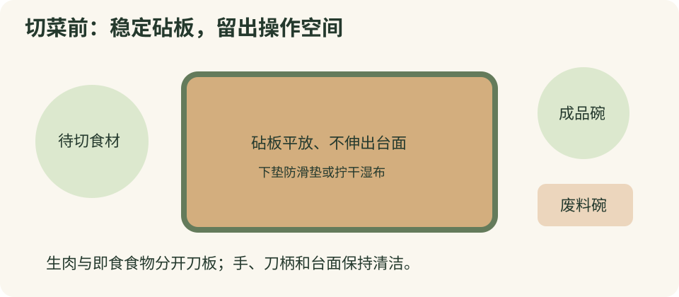
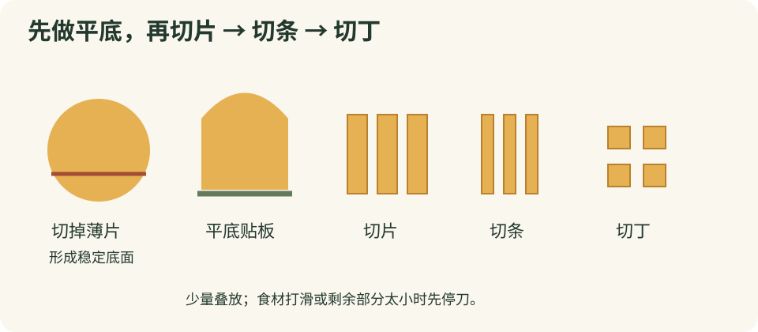
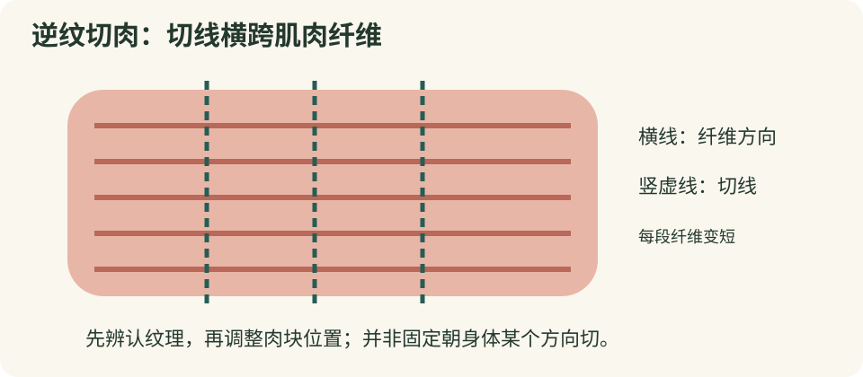

# 学习用刀

这是一份面向家庭厨房初学者的用刀教程。目标是切得稳定、大小合适、清洁安全，不追求速度。先读安全与握刀，再选需要处理的食材；遇到硬骨、坚硬外壳或冻得梆硬的食物，换工具或购买预处理食材。

## 开始前：先把厨房准备好

1. 保持台面明亮、干净，清出足够空间；让儿童、宠物远离操作区域。疲劳、饮酒后或注意力不集中时暂停用刀。
2. 洗净双手并擦干。检查刀柄是否松动、刀刃是否崩口，发现损坏就停用。油腻湿滑的手不能直接握刀。
3. 选完整、平整的木质或食品接触用塑料砧板。砧板下垫防滑垫或拧干的湿布，用手推一下确认不会滑。不要在玻璃、石材、瓷盘上切。
4. 放好待切食材、成品碗和废料碗，砧板前沿不要伸出台面。刀具不用时平放在板上远离边缘的位置，刀刃朝向无人接触的一侧。
5. 生肉、生鱼与熟食、即食果蔬使用分开的刀板；只有一套时先做即食食物，处理生肉后彻底清洗并按清洁产品说明消毒，再换任务。
6. 每次只切少量。生肉分批从冰箱取出，切完及时冷藏或烹调；不要为了练习长时间摊在室温下。

## 必须养成的安全习惯

- 刀掉了就退开，绝不伸手接，也不拿脚挡。等刀落稳后再捡。
- 不拿刀指人、比画或转身讲话；要移开食材、接电话或开柜门，先放下刀。
- 不把刀藏在洗碗水、泡沫、抹布或食材下面。不要将刀散放在抽屉里。
- 尽量在固定位置操作。必须移动时刀尖向下、刀刃避开自己和别人，另一只手不要同时搬重物；不要从人群中挤过。
- 递刀时先放在稳定台面，等对方握住刀柄后取走。不要把刀尖递给别人。
- 不用厨刀开罐、撬瓶盖、拧螺丝、剥硬壳或拆包装。卡刀时停止用力，不扭刀、不敲刀背、不把食物连刀举起砸板。
- 刀锋利仍然会伤人；“保持锋利”是为了减少打滑和蛮力，不代表可以放松护手。
- 防切割手套不能抵御所有刺伤和砍击；如使用，选择适合食品接触、尺寸合适的产品，按说明清洗，仍需正确握持。

## 刀的种类：按任务选择

| 刀具 | 适合做什么 | 不适合做什么 |
| --- | --- | --- |
| 中式片刀、桑刀 | 蔬菜、无骨肉切片切丝；宽刀面便于转移食材 | 斩骨、切硬冻肉；外形宽大不等于可以砍骨 |
| 厨师刀 | 日常切片、切块、切碎；弧形刀刃便于小幅摇切 | 撬壳、扭切硬骨，薄刃尤其易损 |
| 三德刀 | 蔬菜、鱼肉、无骨肉的日常切配 | 强迫刀尖支点摇切、大力斩骨 |
| 削皮刀、小水果刀 | 小块食材修整、去蒂；初学者仍在板上操作 | 拿在掌心快速削切坚硬食物 |
| 锯齿刀、面包刀 | 面包、熟软番茄等，用轻柔拉锯切开 | 砍骨；长刀锯切时另一只手尤其要远离行进路线 |
| 剔骨刀、片鱼刀 | 熟练者沿骨剔肉、片鱼；软硬程度随用途不同 | 新手徒手握肉朝手掌削切 |
| 斩骨刀 | 厂商明确允许的骨类任务 | 当作万能刀；并非所有骨头都能在家处理 |
| 厨房剪 | 剪葱、剪包装、处理厂商允许的软组织 | 超出额定用途剪硬骨；生食使用后未经清洗剪熟食 |

初学者通常先买一把握得稳的主刀、一把小刀和稳定砧板即可；经常吃面包再加锯齿刀。不必为了入门买整套刀。先看用途说明，再看长度、重量和刀柄是否适合自己的手。刀身太长或太重，都会增加控制难度。

不锈钢刀也会锈；碳钢刀更需要及时擦干，表面的正常氧化变色与红褐色锈斑不同。陶瓷刀硬而脆，不适合扭切、拍蒜、切骨或硬冻食物，磨刀通常交给专业人员。

## 认识刀与握刀方法

### 持刀手：稳定优先

刀背是与刀刃相对的厚边，刀尖在前端，刀跟靠近刀柄。部分刀的刀跟也非常锋利，手指不能绕到刃口下方。

整柄握法：手指包住刀柄，拇指自然收稳，不让手指前滑到刀刃。适合刚开始练习或不适合捏握的刀型。

捏握法：拇指和食指轻捏靠近刀柄处的刀身两侧，其余手指环握刀柄；指腹远离下方刃口。适合刀型允许且手感稳定时使用，不要捏刀尖、刀刃或过度向前伸。

握力以刀不转动为准，不要攥到手腕僵硬。手腕尽量自然，肩膀放松；食材太高或太硬时先改变食材形状，不靠抬高手臂加力。

### 辅助手：猫爪手不是护甲

1. 指尖向掌心弯曲，用指尖固定食材，指关节朝向刀的侧面。
2. 拇指收在食材后方，不伸到刀口前面；小指也不要张开。
3. 刀侧可以轻靠弯曲手指的关节作为位置参考，但刃口始终低于引导关节。不要高抬刀越过关节。
4. 每切一次，先让刀停稳，再把辅助手向后挪一点；不要边追刀边移动手。
5. 剩下很短的小块时停下来，平放换方向，或留作别的用途。不必切到最后一毫米。

遇到湿滑的肉、圆形食材或手指无法稳定夹住的小块，先擦去表面多余水分、做平底或换工具。不要只靠“猫爪手”强行切。

## 基本刀法与大小

尺寸用于帮助理解，不是统一标准；以具体菜谱和熟度需要为准。同一锅里的同种食材尽量大小一致，避免外面糊了里面还硬。

| 刀法 | 做法 | 常见用途与示例 |
| --- | --- | --- |
| 切片 | 平底贴板，稳定进刀，逐次退手 | 炒土豆片可从约 2—3 毫米练起；厚薄依菜谱调整 |
| 切条、切丝 | 先切片，少量叠齐或摊开，再切长条 | 初学者从粗条开始，熟练后再切细丝 |
| 切丁 | 条状食材转向，再横切 | 配菜丁可从约 1 厘米练起；不要同时叠太多层 |
| 切块 | 分成大小接近的块 | 炖菜通常比快炒切得大，具体看菜谱 |
| 滚刀块 | 长条食材斜切后转动，再斜切 | 胡萝卜、茄子；每次转动都先抬离刀刃并停稳 |
| 切末 | 先薄片、细条、小丁，再少量切碎 | 姜、蒜、香草；不要把辅助手放在刃口附近 |
| 拉切、推切 | 刀刃带着水平移动切入，不是一直垂直猛压 | 无骨肉、较软蔬菜；移动范围不能碰到另一只手 |
| 轻柔锯切 | 锯齿刀前后移动，减少向下压 | 面包、软番茄，防止压扁 |

摇切只适用于刀型、空间和食材都合适的情况：小幅移动刀柄，保持控制，不追求连续快剁。平直刀刃不必模仿弧刃厨师刀动作。

转移食材优先用刮板或手。使用刀面时先停刀，让刃口远离手指，避免沿砧板横刮刀锋造成钝化。不要用手指沿刀刃擦掉粘附食物。

## 切蔬菜：从稳定的平面开始

### 土豆、胡萝卜、白萝卜：先平底，再片丝丁

1. 清洗，按需要去皮，去掉不能食用的部分。发绿或明显发芽、变质的土豆不要拿来练习或食用。
2. 圆柱状胡萝卜可先截成容易控制的段；切掉一薄片形成平底，平底朝下再切。
3. 先切厚薄接近的片。切丝时只叠少量平稳的片，打滑就摊开逐片切。
4. 切丁先得到等宽条，再横切。不要把长萝卜竖立着往下劈。

### 洋葱：初学者不用横着向手掌切

1. 去掉外皮和干燥顶端，沿根部方向对半切开；切第一刀时先让洋葱稳定，必要时削出小平面。
2. 半颗洋葱切面朝下，根端朝后。顺着顶端到根端方向切数刀，靠近根端保留一点连接。
3. 转向后横着切成丁，利用洋葱自身的分层，不必增加朝向手掌的水平刀。
4. 到根端附近就停止，把难以固定的末端单独平放处理或弃去。

不要闭着眼睛切洋葱。流泪影响视线时先放下刀、离开砧板，恢复后再继续。

### 青椒、甜椒、辣椒

把椒放稳，纵向剖开，平放后去籽和白色内筋，再切条或丁。皮面打滑时把内侧朝上。处理辣椒后避免触摸眼睛；可用食品接触用手套，结束后洗手并清洁刀板。

### 番茄、茄子、黄瓜

番茄用锋利薄刃刀轻拉，或用锯齿刀轻锯，禁止因为打滑而突然加力。黄瓜、茄子先去蒂，再纵向切出稳定底面或对半平放。做滚刀块时少量切、逐次停刀转动，不让食材滚向刀口。

### 叶菜、葱与香草

先清洗、沥去多余水分，去掉坏叶。叶菜少量叠放，轻卷后切段或丝，不卷成很高的菜堆。葱切短段再对齐处理，葱白较滑时减少数量。香草先聚拢再切，不在落刀时伸手捡散叶。

### 姜、蒜与蘑菇

姜切出平底，先片后丝再末。蒜可剥皮后切片、切末，或用压蒜器；不建议初学者模仿用刀面猛拍蒜，尤其不能拍陶瓷刀或薄脆刀。蘑菇去掉不需要的根部，大颗对半后切面朝下；小颗不好固定时可保留整颗按菜谱烹调。

### 南瓜、冬瓜、玉米等较硬食材

大块南瓜、带硬皮瓜类最重要的是稳定和工具匹配。初学者优先买分切块；不要为了切开而敲击刀背、踩刀、举刀砸板。刀进入后卡住就停下，不左右扭动刀刃。

玉米粒可用专用脱粒器。用刀时先取得能平放的稳定小段，低位固定，刀刃远离持物手，逐面削下；不会稳定固定就买现成玉米粒。不要把整根玉米高高竖起在光滑台面上削。

## 切肉：看纹理，也看是否带骨

### 无骨牛肉、猪肉：逆纹理切片

肉上的细长平行纤维就是纹理。逆纹理切是让切口横跨纤维，缩短每口肉中的长纤维；不是固定朝某个身体方向切。

1. 生肉在冷藏条件下解冻；不要切硬冻肉，也不要放在室温下长时间等它软化。
2. 擦去表面多余汁液，使用生肉专用刀板，切下的肉及时放入容器。
3. 看清纤维方向，把肉摆成容易横断纤维的位置。没有平底就先分成能稳定平放的块。
4. 用平稳拉切得到厚薄接近的片；炒肉片可从约 2—4 毫米练起，仍按菜谱调整。不要用手把肉悬空拉紧后朝手切。
5. 切丝可先切片、再切条；做炖肉则切成大小接近的块。不同部位纤维方向可能变化，转动肉块重新观察。

“牛横切、猪竖切”一类口诀不能代替观察部位和菜谱。是否逆纹、切多厚、是否需要保持形状，要结合成菜要求；对需要嫩口的快炒无骨肉，缩短纤维通常更容易咀嚼。

### 鸡胸肉、鸡腿肉与带骨禽肉

鸡胸肉平放，去掉明显筋膜后切片或块；初学者不把手掌压在肉上进行水平片薄，可以购买薄切肉。鸡腿优先买去骨肉，展开后分块。不要用片刀硬砍关节、腿骨或冷冻鸡块，请商家分切。

不要冲洗生鸡肉，以免飞溅污染周围。切生禽后清洗双手、刀板、台面及接触过的把手；装过生肉的盘子不能直接装熟肉。肉切薄并不等于熟得安全，烹调仍需遵循食谱与食品安全要求。

### 鱼肉、虾与海鲜

入门优先选择去骨鱼片。鱼片擦去多余水分、平放，轻柔拉切，避免把肉压碎；发现鱼刺用专用鱼骨钳取出并检查，不能只凭“无骨”标签省略观察。

整鱼去骨、去皮和贝类开壳涉及滑动、尖刺与特殊工具，可让商家处理。虾可用厨房剪处理虾背，再挑去需要去除的部分；不要握在掌心用尖刀向手刺。牡蛎、椰子、蟹壳等不能用普通厨刀硬撬。

### 熟肉与剩菜

用清洁且未接触生肉的刀板切熟肉，按肉纹理与菜谱需要切片。别用手强压刚出锅的烫肉，放到适合操作的温度后再切，同时避免长时间放在室温。切好的剩菜及时妥善冷藏。

## 水果、面包、豆腐和其他食材

### 苹果、梨、柑橘

洗净后在板上分切。苹果、梨先切出平面，再分瓣，平放后去核；不要把果瓣捧在手心朝掌心削核。柑橘能手剥就手剥，需要切片时先切出稳定底面。

### 牛油果、芒果与有核水果

成熟牛油果可优先用专用工具。使用刀时在砧板上稳定果实，缓慢绕核切开，停刀后用手分开两半，再用勺子取核和果肉。不要把半颗果实握在掌心，用刀劈核或用刀尖挑核。

芒果先形成稳定底面，沿扁核两侧分下果肉；切小块时把果肉从皮上取到板上再切。不要捧着果皮划格子，让刀尖有机会穿皮扎手。桃、李等切开后用手分离或勺取核，不拿刀硬撬。

### 西瓜、菠萝与硬壳果实

大西瓜、菠萝先考虑重量和砧板大小；控制不住就购买分切份。能稳定操作时先形成平底，分成小块后再修皮。不要在滚动的完整大果实上横着用力劈。椰子等坚硬外壳需要专门工具和操作条件，普通厨刀不适合。

### 面包、蛋糕、豆腐与奶酪

面包用锯齿刀轻锯，固定面包的手远离刀的前后路线；越到下层越减力，避免突然穿透。蛋糕用清洁长刀平稳切，停刀后再擦掉附着物。

豆腐轻放在板上，用薄而锋利的刀切块，不用手挤压；奶酪粘刀时减少单次厚度或用合适的奶酪刀，不扭着刀把大块撬开。处理坚果硬壳用专用夹具，冰块和硬糖也不要拿厨刀砍。

## 清洗、擦干与收纳

1. 用完马上单独处理刀具，握住刀柄，让刀刃远离身体和另一只手。
2. 用温水、温和洗涤剂和不易划伤刀面的清洁工具清洗。清洁方向避开刃口，不用海绵或抹布包住刀刃来回捋，也不徒手擦刃口。
3. 生食污染后的刀板先去污清洗，再按适用消毒产品说明操作；浓度、接触时间和是否冲洗以产品要求为准，不能随意混合清洁剂。
4. 冲净后小心擦干刀面、刀柄连接处和刀柄，避开刀刃。不要长时间浸泡，不建议放洗碗机，特别是木柄、碳钢或厂商禁止机洗的刀。
5. 完全干燥后放刀鞘、刀架或有独立槽位的抽屉。刀架也需清洁干燥；磁吸架需牢固、避开儿童，并按厂商方式取放，避免刃口碰撞。

木柄按厂家说明保养，使用允许接触食品的养护产品；不要自行涂工业机油。碳钢刀切酸性食物后尽快洗净擦干，长期收纳是否薄涂食品接触用防锈油按说明决定，使用前清洁。发现锈蚀、裂纹、刀柄松动或明显崩口，应先维修或更换。

## 磨刀、整刃与判断锋利程度

### 什么时候需要维护

同样的食材需要更大力气、切番茄总打滑、压碎葱叶而不是切断，都提示刀刃可能需要维护，也要检查是否选错刀、砧板打滑或食材没有平底。

不要用手指划刀锋、剃毛或在手上切纸测试。可在板上用正常食材、正常切法观察是否顺畅；有崩口时不要继续试切。

### 整刃棒和磨刀石的区别

部分钢质整刃棒主要帮助整理轻微偏移的刃口；陶瓷棒、金刚石棒也可能磨去金属。不同刀材、硬度和刃型对工具要求不同，日式薄刃、单刃刀或陶瓷刀不能照搬其他刀的维护方法。

磨刀石通过磨去少量材料恢复刃口。角度没有适合所有刀的统一数字，应优先遵循厂家给出的单侧角度、刃型和磨具说明。把双面夹角误当成单侧角度，会把刃磨坏。

### 初学者维护流程

1. 查刀具说明，确认能否自行磨、适用磨具及角度。不清楚时交给专业磨刀服务。
2. 把磨石或导向磨刀器固定在防滑底座，台面干净、光线充分；是否浸泡、加水或用油按磨具说明，不把所有磨石都泡水。
3. 使用导向工具或按已学会的稳定动作轻磨，手指始终离开刀刃移动路线。不把磨刀棒悬在空中快速挥刀表演。
4. 不为追求锋利猛压、磨出过薄刃口；锯齿刀、单刃刀和陶瓷刀交给熟悉对应刀型的人维护。
5. 结束后清洁刀具与台面上的金属磨屑，擦干收好。磨过的刀手感会变，先慢速切少量食材。

磨刀频率取决于使用强度、刀材、砧板与手法，不必按固定天数磨。用合适砧板、避免横向刮刃、单独收纳，往往比频繁磨刀更重要。

## 常见问题排查

| 问题 | 先检查 | 更稳妥的处理 |
| --- | --- | --- |
| 食材滚动 | 没有平底、板太滑 | 停刀，做平底，固定砧板 |
| 刀在皮上打滑 | 刀钝、表面湿、用刀不合适 | 擦干多余水分，换锋利刀或合适锯齿刀 |
| 切片忽厚忽薄 | 叠太多、退手不一致、动作太快 | 减少数量，一刀一停，从厚片练起 |
| 肉被压烂 | 刀钝、肉太软、一直向下猛压 | 冷藏保持结实，换锋利刀平稳拉切 |
| 刀卡在硬食材里 | 任务超出刀具能力 | 停止扭撬或敲击，改买分切食材或请商家处理 |
| 手腕酸痛 | 刀太重、台面高度不适、握力过大 | 暂停休息，调整工具与姿势，持续疼痛及时就医 |
| 食材粘刀 | 切面湿润或含淀粉 | 停刀后用合适工具移开，不沿刀刃抹 |

## 分阶段练习：不计时、不比快

1. 第一阶段只练摆台、握刀、猫爪手和停刀。选容易固定的半根黄瓜或软硬适中的蔬菜，切少量厚片。
2. 第二阶段用有平底的土豆练片、条、丁，检查大小接近即可，不追求细如发丝。
3. 第三阶段练洋葱丁、椒丝与叶菜段，感受不同食材的稳定方式。
4. 第四阶段在单独生肉刀板上练无骨肉片，先辨认纹理，再切少量，最后完成清洁消毒。
5. 每次结束复盘：砧板是否移动、拇指是否露出、有没有蛮力压刀、切到小末端时有没有主动停下、刀有没有及时收好。

每阶段都以能稳定慢做为进入下一阶段的条件。未成年人应由具备操作能力的成年人当面指导，依据年龄和能力选择适合的工具与任务。

## 不小心割伤时

立即放下刀，停止接触食材。小伤口可用干净敷料或布持续直接按压止血；如果有扎入物，不自行拔除或直接压在异物上，应在周围施压并就医。敷料浸透时在上面加一层，避免反复掀开看。

止血后，小而表浅的伤口可用干净流动水冲洗、清洁周围皮肤，再覆盖无菌敷料。伤口污染的食物丢弃，清洁受污染台面。不要往伤口撒盐、咖啡粉或使用食材偏方。

出血无法控制、喷射出血、伤口深大、手掌严重受伤、麻木、活动受限或有异物时，立即寻求医疗帮助；在中国大陆紧急情况拨打 120。后续出现红肿加重、流脓、发热等也应就医，由医务人员评估感染及破伤风预防需要。文字教程不能替代现场急救培训。

## 资料来源与图文说明

以下资料用于核对通用安全、保养和急救原则；具体食材切法是面向家庭厨房的原创整理，并非逐字翻译。查阅日期：2026 年 10 月 18 日。

- [英国健康与安全执行局：厨房安全用刀](https://www.hse.gov.uk/catering/knives.htm)：合适刀具、稳定切面、安全携带与收纳、不接掉落的刀。
- [英国食品标准局：避免交叉污染](https://www.food.gov.uk/safety-hygiene/avoiding-cross-contamination)：食物、工具与操作面之间的污染传播。
- [双立人：刀具使用与保养](https://www.zwilling.com/us/about-us/use-care/article-use-care-knives.html)：手洗、擦干、避免洗碗机损伤和独立存放；其他品牌仍以其说明为准。
- [英国国民医疗服务体系：割伤与擦伤](https://www.nhs.uk/conditions/cuts-and-grazes/)：止血、清洁覆盖以及需紧急医疗处理的征象。

本文文字及三幅示意图为本次贡献原创内容，按 The Unlicense 提供。外部资料只作参考链接，不包含转载图片；示意图用于解释布局、切形与纤维方向，不表示真实比例，也不代替现场动作示范。
